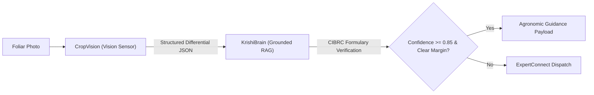

# KISANVISION — AGRICULTURAL DIFFERENTIAL DIAGNOSIS OUTPUT CONTRACT

**Document Version:** 1.0.0  
**Effective Date:** November 7, 2026  
**Status:** Approved System Interface Contract  
**Parties:** CropVision (Vision Model) $\longleftrightarrow$ KrishiBrain (RAG) & ExpertConnect (Human Review)  

---

## 1. Architectural Boundary & Separation of Concerns

A fundamental vulnerability in poorly designed agricultural AI chatbots is allowing the raw vision model or multimodal LLM to unilaterally invent chemical treatments, spray dosages, or yield recovery promises directly from a photograph.

KisanVision enforces an absolute architectural separation:
1. **CropVision (The Vision Model):** Acts purely as an empirical visual observation sensor. It identifies visual foliar patterns, ranks differential candidates, quantifies uncertainty, and highlights missing field evidence.
2. **KrishiBrain (The Grounded RAG Engine):** Retrieves verified PJTSAU / ICAR agronomic management protocols and cross-references active chemical ingredients against the CIBRC registered formulary.
3. **ExpertConnect (Human Agronomist Review):** Validates and signs off on high-risk, ambiguous, or severe pesticide recommendations.



---

## 2. Mandatory Negative Invariants

Under NO circumstances may CropVision output:
- ❌ **Unilateral Chemical Prescriptions:** The vision model must never recommend a brand name (e.g. *Confidor*, *Bavistin*) or chemical active ingredient on its own.
- ❌ **Invented Dosages:** Never output dosage rates (e.g. "2 ml per liter") without formal CIBRC formulary lookup.
- ❌ **Guaranteed Outcomes:** Never output statements like "Spraying this will cure 100% of the disease" or "Yield will increase by 20%".
- ❌ **Definitive Single-Class Declarations under High Entropy:** When symptom entropy $\bar{H} > 0.65$, CropVision must present multiple differential candidates.

---

## 3. Formal JSON Schema Contract

```json
{
  "$schema": "https://json-schema.org/draft/2020-12/schema",
  "title": "KisanVisionDifferentialDiagnosisOutput",
  "type": "object",
  "required": [
    "request_id",
    "timestamp",
    "crop",
    "decision_state",
    "differential_candidates",
    "uncertainty_metrics",
    "image_quality",
    "ood_assessment",
    "missing_evidence",
    "suggested_follow_up_questions",
    "safety_invariants"
  ],
  "properties": {
    "request_id": { "type": "string", "format": "uuid" },
    "timestamp": { "type": "string", "format": "date-time" },
    "crop": {
      "type": "object",
      "required": ["selected_crop", "verified_by_model", "confidence"],
      "properties": {
        "selected_crop": { "type": "string", "enum": ["cotton", "rice", "chilli"] },
        "verified_by_model": { "type": "boolean" },
        "confidence": { "type": "number", "minimum": 0.0, "maximum": 1.0 }
      }
    },
    "decision_state": {
      "type": "string",
      "enum": [
        "SUPPORTED_PREDICTION",
        "NEEDS_MORE_INFORMATION",
        "LOW_CONFIDENCE",
        "IMAGE_QUALITY_INSUFFICIENT",
        "UNSUPPORTED_CROP",
        "OUT_OF_DISTRIBUTION",
        "EXPERT_REVIEW_REQUIRED",
        "PROCESSING_FAILED"
      ]
    },
    "differential_candidates": {
      "type": "array",
      "minItems": 1,
      "maxItems": 5,
      "items": {
        "type": "object",
        "required": ["rank", "class_id", "display_names", "calibrated_probability", "symptom_match_points"],
        "properties": {
          "rank": { "type": "integer", "minimum": 1 },
          "class_id": { "type": "string" },
          "display_names": {
            "type": "object",
            "required": ["en", "te", "hi"],
            "properties": {
              "en": { "type": "string" },
              "te": { "type": "string" },
              "hi": { "type": "string" }
            }
          },
          "pathogen_or_cause": { "type": ["string", "null"] },
          "calibrated_probability": { "type": "number", "minimum": 0.0, "maximum": 1.0 },
          "symptom_match_points": { "type": "array", "items": { "type": "string" } }
        }
      }
    },
    "uncertainty_metrics": {
      "type": "object",
      "required": ["normalized_entropy", "prediction_margin", "temperature_applied"],
      "properties": {
        "normalized_entropy": { "type": "number", "minimum": 0.0, "maximum": 1.0 },
        "prediction_margin": { "type": "number", "minimum": 0.0, "maximum": 1.0 },
        "temperature_applied": { "type": "number", "minimum": 0.1 }
      }
    },
    "image_quality": {
      "type": "object",
      "required": ["overall_status", "sharpness_score", "exposure_status", "camera_guidance"],
      "properties": {
        "overall_status": { "type": "string" },
        "sharpness_score": { "type": "number" },
        "exposure_status": { "type": "string" },
        "camera_guidance": { "type": "array", "items": { "type": "string" } }
      }
    },
    "ood_assessment": {
      "type": "object",
      "required": ["is_foliar_verified", "foliar_pixel_ratio", "energy_score"],
      "properties": {
        "is_foliar_verified": { "type": "boolean" },
        "foliar_pixel_ratio": { "type": "number" },
        "energy_score": { "type": ["number", "null"] }
      }
    },
    "missing_evidence": {
      "type": "array",
      "items": { "type": "string" },
      "description": "Crucial agronomic context that cannot be determined from a 2D leaf photo alone (e.g. soil moisture, recent rainfall, undersurface inspection)."
    },
    "suggested_follow_up_questions": {
      "type": "array",
      "items": { "type": "string" },
      "description": "Targeted diagnostic questions for the farmer in Telugu/English."
    },
    "safety_invariants": {
      "type": "object",
      "required": ["cibrc_verification_required", "chemical_treatment_prescribed", "guaranteed_cure_claimed"],
      "properties": {
        "cibrc_verification_required": { "type": "boolean", "const": true },
        "chemical_treatment_prescribed": { "type": "boolean", "const": false },
        "guaranteed_cure_claimed": { "type": "boolean", "const": false }
      }
    }
  }
}
```
