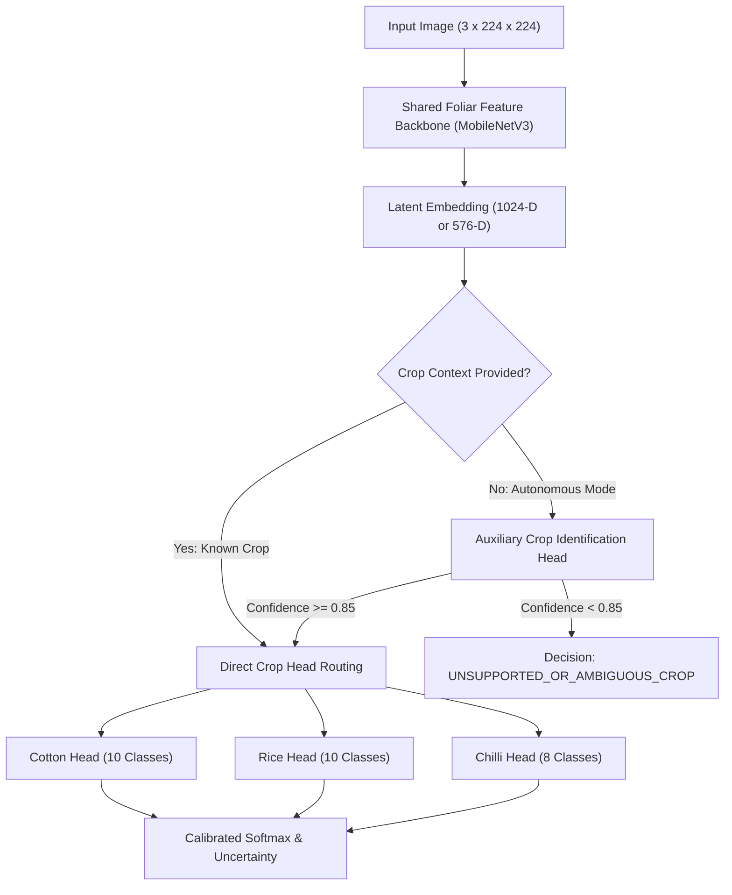

# KISANVISION — MULTI-CROP MODEL STRATEGY

**Document Version:** 1.0.0  
**Effective Date:** November 7, 2026  
**Status:** Approved Architectural Decision  
**Target Crops:** Cotton (*Gossypium hirsutum*), Rice (*Oryza sativa*), Chilli (*Capsicum annuum*)  

---

## 1. Executive Summary

A critical architectural decision for KisanVision is whether to deploy independent single-crop models, a single monolithic multi-crop model, or a shared multi-task representation.

In real-world smallholder agriculture in Telangana, smallholders typically hold distinct plots for Cotton, Paddy (Rice), or Chilli. When a farmer launches CropVision, they almost always select their active crop or plot context. However, an automated system must also gracefully handle ambiguous captures, unsupported crops (e.g. Tomato, Mango, Maize), and non-plant imagery without cross-crop diagnostic hallucination.

This document formally evaluates four architectural approaches and specifies the **Hierarchical Multi-Task Shared Backbone with Isolated Crop Heads (Approach C+D)** as KisanVision's primary production model strategy.

---

## 2. Comparative Evaluation of Multi-Crop Approaches

| Dimension | Approach A: Isolated Independent Models | Approach B: Single Monolithic Model (28 Classes) | Approach C: Shared Backbone + Crop Heads | Approach D: Hierarchical Gated Routing (Selected C+D) |
| :--- | :---: | :---: | :---: | :---: |
| **Model Disk Footprint** | High ($3 \times 3.69 \text{ MB} \approx 11.1 \text{ MB}$) | Low ($1 \times 4.2 \text{ MB}$) | Very Low ($1 \text{ Backbone} + 3 \text{ Heads} \approx 3.9 \text{ MB}$) | **Optimal (~4.0 MB)** |
| **Cross-Crop Diagnostic Contamination** | Zero (Strictly impossible) | High (Rice Blast may misclassify as Cotton Blight) | Zero (Softmax normalized per crop head) | **Zero (Strictly gated)** |
| **Negative Transfer Risk** | None | Severe | Low (Mitigated by head isolation) | **Low** |
| **Class Imbalance Bleeding** | None | Severe across crops | Minimal | **Minimal** |
| **Unknown Crop Rejection** | Requires separate OOD filter | Confident wrong prediction | Crop Head can reject low confidence | **Dedicated Crop Gate detects unknown crops** |
| **Inference CPU Latency** | Fast (~3.0 ms per crop) | Fast (~3.2 ms) | Fast (~3.1 ms) | **Ultra-Fast (~3.2 ms total)** |
| **Deployment & Updates** | Independent model releases | Must retrain all 28 classes | Can retrain head or joint backbone | **Modular & Maintainable** |

---

## 3. Selected Strategy: Approach C+D (Hierarchical Shared Multi-Task Architecture)

### 3.1 Structural Topology

### 3.2 Key Architectural Invariants:
1. **Isolated Softmax Normalization:**
   Softmax probability is NEVER computed over the joint 28 classes. A Cotton symptom prediction is normalized strictly over the 10 Cotton taxonomy classes:
   $$p_i^{\text{cotton}} = \frac{\exp(z_i / T_{\text{cotton}})}{\sum_{k=1}^{10} \exp(z_k / T_{\text{cotton}})}$$
   This guarantees that a Rice disease can NEVER be predicted for a Cotton crop, completely eliminating cross-crop contamination.
2. **Autonomous Unknown Crop Rejection:**
   The auxiliary crop gating head classifies among `{Cotton, Rice, Chilli, Unknown}`. If a farmer uploads a leaf from an unsupported crop (e.g. Maize, Soybean, Tomato), the crop gate abstains with `UNSUPPORTED_CROP` before any pathology head executes.
3. **Edge Optimization:**
   The shared backbone requires only 1 pass through the CNN feature extractor ($~3.0\text{ ms}$ on CPU). The linear heads execute in $<0.1\text{ ms}$, ensuring sub-5ms total execution time on host hardware.

---

## 4. Implementation Specifications

The architecture is implemented in:
- Model Class: [`MultiCropKisanVisionClassifier`](file:///C:/Users/gokul/OneDrive/Documents/projects/ml/models/multi_crop.py)
- Configuration: `ml/configs/experiments/multicrop_mobilenet.yaml`
- Supported Crops: `cotton`, `rice`, `chilli`
- Fallback: Autonomous crop gate routing when crop context is omitted.
