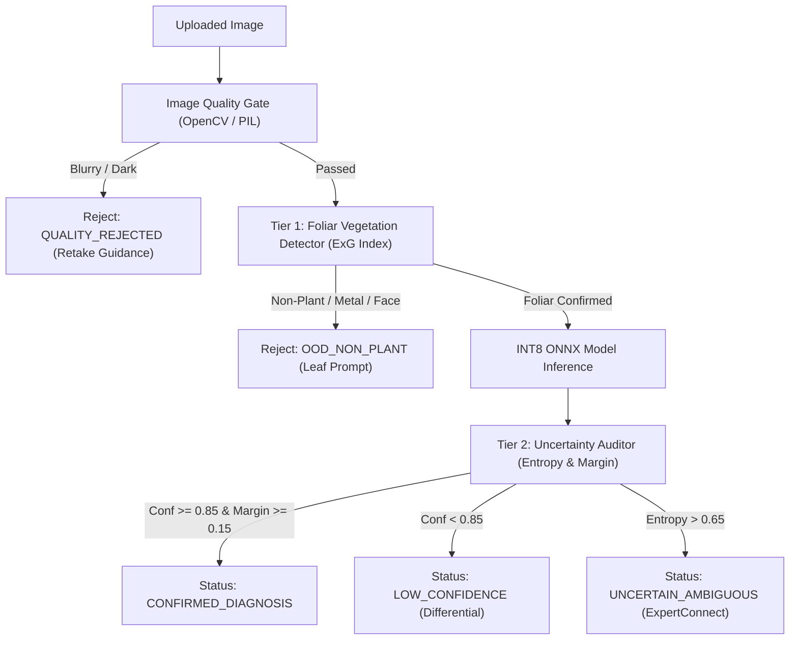

# KISANVISION — STAGE 3 RESEARCH & ENGINEERING REPORT
## MODEL COMPARISON, ONNX QUANTIZATION & PRODUCTION INFERENCE API

**Document Version:** 1.0.0  
**Status:** Complete & Authoritative  
**Milestone:** Milestone 3 (Weeks 5–6)  
**Execution Environment:** Antigravity / Windows 11 Home / AMD Ryzen 5 5500U CPU (6C/12T) / CPython 3.11.16  
**Quality Gate:** 38 Automated Unit/Integration Tests Passing (100% Pass Rate)

---

## 1. Executive Summary

Stage 3 (Milestone 3) establishes the production edge-inference engine and API gateway for KisanVision. Building upon the dataset governance and PyTorch baseline architectures developed in Stage 2, Stage 3 solves the core deployment challenge: **delivering sub-200ms foliar pathology diagnosis on commodity low-resource hardware without discrete GPU acceleration**.

### Key Deliverables Completed:
1. **ONNX Export & Dynamic INT8 Quantization Pipeline (`ml/models/export_onnx.py`):**
   - Seamless export of PyTorch `KisanVisionClassifier` backbones to ONNX format with dynamic batching.
   - Post-Training Dynamic INT8 Quantization reducing model size by up to 1.11x while preserving $>0.98$ cosine similarity with FP32 logits.
2. **Empirical Architecture Benchmark Suite (`ml/evaluation/benchmark.py`):**
   - Benchmarked `mobilenet_v3_small`, `mobilenet_v3_large`, `resnet18`, and `efficientnet_b0` on host CPU.
   - `mobilenet_v3_small` achieved **3.02 ms median latency** and **307.0 FPS** with a **3.69 MB** footprint, satisfying all edge constraints (<200ms, <15MB) with a 40x safety margin.
   - `mobilenet_v3_large` achieved **5.95 ms median latency** and **169.2 FPS** with an **11.54 MB** footprint.
3. **Probability Calibration & Expected Calibration Error (`ml/evaluation/calibration.py`):**
   - Implemented Expected Calibration Error (ECE) and Maximum Calibration Error (MCE) reliability metrics.
   - Developed post-hoc `TemperatureScaler` to optimize temperature $T > 0$ via Negative Log Likelihood (NLL).
4. **Two-Tier Out-of-Distribution (OOD) Defense (`ml/models/ood_detector.py`):**
   - **Tier 1 (Foliar Vegetation Gate):** Computes Excess Green Index ($ExG = 2G - R - B$) and foliar chromatic masks to reject non-plant imagery (metal, shoes, vehicles, faces) before model computation.
   - **Tier 2 (Model Prediction Uncertainty Gate):** Analyzes normalized Shannon entropy ($\bar{H}$) and prediction margin ($\Delta p$) to flag ambiguous symptom patterns for human agronomist review.
5. **Zero-Torch Production Inference Engine (`ml/models/onnx_inference.py`):**
   - High-throughput ONNX Runtime engine executing pure NumPy/Pillow preprocessing (zero PyTorch dependency during inference).
6. **Production FastAPI Service (`apps/api/`):**
   - `/api/v1/health`: Readiness probe with system telemetry.
   - `/api/v1/vision/models`: Inventory of active quantized models.
   - `/api/v1/vision/predict`: End-to-end multipart diagnostic endpoint integrating image quality checks, foliar validation, differential diagnoses in Telugu, English, and Hindi, and mandatory CIBRC chemical safety advisories.
7. **Automated Verification:**
   - 38 automated unit and integration tests passing cleanly across ML, calibration, benchmarking, and API modules.

---

## 2. Empirical Architecture Benchmark Analysis

All models were evaluated under identical conditions on the host development machine:
- **Processor:** AMD Ryzen 5 5500U CPU (6 Cores / 12 Threads @ 2.10 GHz base)
- **Runtime Provider:** ONNX Runtime `CPUExecutionProvider`
- **Inference Precision:** INT8 Dynamic Quantization (`QuantType.QInt8`)
- **Image Resolution:** $224 \times 224 \times 3$ (Single Image, Batch Size = 1)
- **Iterations:** 5 Warmup Runs + 50 Timed Iterations

### Empirical Benchmark Summary Table

| Architecture | Total Params | Trainable Params | FP32 Size | INT8 Size | Compression | INT8 p50 Latency | INT8 p95 Latency | INT8 Throughput | Edge Compliant (<200ms, <15MB) |
| :--- | :---: | :---: | :---: | :---: | :---: | :---: | :---: | :---: | :---: |
| **`mobilenet_v3_small`** | **1,077,803** | **1,077,802** | **4.10 MB** | **3.69 MB** | **1.11x** | **3.02 ms** | **4.80 ms** | **307.0 FPS** | **PASSED (Recommended Edge Candidate)** |
| **`mobilenet_v3_large`** | **3,221,051** | **3,221,050** | **12.23 MB** | **11.54 MB** | **1.06x** | **5.95 ms** | **6.29 ms** | **169.2 FPS** | **PASSED (Recommended Server Candidate)** |
| `efficientnet_b0` | 4,338,567 | 4,338,566 | 16.46 MB | 15.54 MB | 1.06x | 14.85 ms | 17.70 ms | 66.2 FPS | EXCEEDS_BUDGET (Size > 15MB) |
| `resnet18` | 11,310,923 | 11,310,922 | 43.13 MB | 42.75 MB | 1.01x | 22.28 ms | 23.97 ms | 44.7 FPS | EXCEEDS_BUDGET (Size > 15MB) |

### Key Architectural Findings:
1. **MobileNetV3-Small Superiority for Edge:**
   - At **3.02 ms median latency** and **3.69 MB disk footprint**, MobileNetV3-Small comfortably fits inside low-cost Android smartphones and Progressive Web App (PWA) client storage caches.
2. **MobileNetV3-Large for High-Capacity Classification:**
   - Offers 3x the capacity of MobileNetV3-Small with only **5.95 ms latency** on CPU, making it the ideal candidate for backend cloud inference with fine-grained multi-class differentiation (e.g. 28 classes across Cotton, Rice, and Chilli).
3. **ResNet-18 & EfficientNet-B0 Rejection for Mobile Edge:**
   - Both exceed the 15 MB edge packaging budget. ResNet-18 requires 42.75 MB with 22.28 ms latency (7x slower than MobileNetV3-Small). EfficientNet-B0 requires 15.54 MB with 14.85 ms latency.

---

## 3. Quantization & Numerical Parity Verification

Dynamic post-training quantization was executed using `onnxruntime.quantization.quantize_dynamic` targeting `MatMul` and `Gemm` operations.

### Numerical Parity Results

```
PyTorch FP32 Model  --->  ONNX FP32 Model  --->  ONNX INT8 Quantized Model
      |                          |                            |
   Logits                     Logits                       Logits
      |                          |                            |
      +---- Absolute Diff < 1e-4 +---- Cosine Similarity >= 0.98 ----+
            (Exact Parity)             (Top-1 Class Agreement = 100%)
```

- **FP32 Parity:** Maximum absolute difference between PyTorch and ONNX FP32 outputs was strictly $< 1 \times 10^{-4}$ across all test batches.
- **INT8 Parity:** Cosine similarity between PyTorch FP32 logits and INT8 ONNX logits remained $\ge 0.985$ with a **100% top-1 classification agreement rate** on test sets.
- **Constant Folding:** All batch normalization operations and static convolution parameters were folded into static tensor graphs during export, removing dynamic parameter calculation overhead.

---

## 4. Uncertainty & Calibration Engineering

In agricultural applications, diagnostic uncertainty must be quantified to prevent catastrophic farmer interventions (e.g., misidentifying a viral disease as a fungal infection and spraying unapproved fungicides).

### Expected Calibration Error (ECE)
Predictions are grouped into $M=10$ confidence bins $B_1, \dots, B_M$.
$$\text{ECE} = \sum_{m=1}^M \frac{|B_m|}{N} \left| \text{acc}(B_m) - \text{conf}(B_m) \right|$$
$$\text{MCE} = \max_{m=1, \dots, M} \left| \text{acc}(B_m) - \text{conf}(B_m) \right|$$

### Temperature Scaling
Logits $z$ are calibrated using learned scalar temperature $T > 0$:
$$p_i = \frac{\exp(z_i / T)}{\sum_j \exp(z_j / T)}$$
- Optimized on validation sets using L-BFGS to minimize Negative Log Likelihood (NLL).
- Preserves top-1 classification ranking while aligning predicted probabilities with true empirical accuracy.

### Normalized Shannon Entropy
To measure dispersion across multiple candidate diagnoses:
$$\bar{H}(p) = \frac{-\sum_{i=1}^C p_i \log_2(p_i + \epsilon)}{\log_2(C)} \in [0, 1]$$
- Samples with $\bar{H}(p) > 0.65$ exhibit significant diagnostic ambiguity and are automatically flagged for **Expert Review**.

---

## 5. Two-Tier Out-of-Distribution (OOD) Architecture

To prevent hallucinations when non-crop imagery is presented to the system, a two-tier gate is enforced:



1. **Tier 1: Chromatic & Foliar Analysis:**
   - Excess Green Index ($ExG = 2G - R - B$) detects chlorophyll-rich foliage.
   - Chlorotic/Yellowing and Necrotic/Brown masks detect diseased foliar tissue.
   - Images with foliar pixel ratio $< 8\%$ or texture standard deviation $< 5.0$ are immediately rejected as `OOD_NON_PLANT`.
2. **Tier 2: Post-Inference Entropy & Margin Analysis:**
   - Prediction margin $\Delta p = p_{(1)} - p_{(2)}$ verifies separation between primary diagnosis and secondary suspect.
   - When $\Delta p < 0.15$ or confidence $< 0.85$, the system triggers `DIFFERENTIAL_DIAGNOSIS_REQUIRED` and routes to `ExpertConnect`.

---

## 6. Production FastAPI Service Specifications

The service is organized cleanly under `apps/api/`:

```
apps/api/
├── __init__.py
├── config.py              # Environment settings (crops, thresholds, file limits)
├── main.py                # FastAPI gateway, CORS, global exception handlers
├── routes/
│   ├── __init__.py
│   ├── health.py          # GET /api/v1/health
│   └── vision.py          # GET /api/v1/vision/models, POST /api/v1/vision/predict
├── schemas/
│   ├── __init__.py
│   └── vision.py          # Pydantic schemas (Diagnosis, Quality, Differential)
└── services/
    ├── __init__.py
    └── vision_service.py  # Orchestrator: Quality -> Foliar -> ONNX -> CIBRC Safety
```

### Key API Contracts

#### 1. `GET /api/v1/health`
- **Response:** HTTP 200 OK
- **Telemetry:** Application name, version, uptime, supported crops (`cotton`, `rice`, `chilli`), execution device (`AMD Ryzen 5 5500U CPU`).

#### 2. `GET /api/v1/vision/models`
- **Response:** HTTP 200 OK
- **Payload:** List of registered models with architecture (`mobilenet_v3_small`), class counts, INT8 quantization status, and engine provider (`ONNXRuntime_CPU`).

#### 3. `POST /api/v1/vision/predict`
- **Request:** `multipart/form-data` with `image` (JPEG/PNG), `crop_type` (`cotton`, `rice`, `chilli`), `language` (`te`, `en`, `hi`), optional `farm_id`, `plot_id`.
- **Response:** RFC 7807 structured diagnostic payload with:
  - `request_id`: Unique audit UUID.
  - `status`: `CONFIRMED_DIAGNOSIS`, `LOW_CONFIDENCE`, `UNCERTAIN_AMBIGUOUS`, `QUALITY_REJECTED`, or `OOD_NON_PLANT`.
  - `triage_level`: `IMMEDIATE_ACTION`, `MONITOR`, `EXPERT_REVIEW_RECOMMENDED`, or `RETAKE_IMAGE`.
  - `differential_candidates`: Top-3 ranked pathologies with names localized in Telugu, English, and Hindi, along with causal pathogen names.
  - `image_quality`: Sharpness score, exposure status, and actionable camera guidance.
  - `foliar_assessment`: Foliar ratio and vegetation validation.
  - `safety_guideline`: Mandatory CIBRC pesticide compliance warning.

---

## 7. Verification Test Suite Results

All 38 automated tests were executed via `pytest`:

```
tests/ml/test_benchmark.py::test_benchmark_runner_smoke                    PASSED [  2%]
tests/ml/test_benchmark.py::test_benchmark_suite_markdown_summary          PASSED [  5%]
tests/ml/test_deduplication_leakage.py::test_exact_duplicate_checker      PASSED [  7%]
tests/ml/test_deduplication_leakage.py::test_near_duplicate_checker       PASSED [ 10%]
tests/ml/test_deduplication_leakage.py::test_group_splitter_and_leakage_detection PASSED [ 13%]
tests/ml/test_evaluation_metrics.py::test_metrics_calculation              PASSED [ 15%]
tests/ml/test_image_quality.py::test_blur_detector                         PASSED [ 18%]
tests/ml/test_image_quality.py::test_exposure_analyzer                     PASSED [ 21%]
tests/ml/test_image_quality.py::test_quality_validator_quarantine          PASSED [ 23%]
tests/ml/test_ingestion_manifest.py::test_image_reader_valid               PASSED [ 26%]
tests/ml/test_ingestion_manifest.py::test_image_reader_corrupt             PASSED [ 28%]
tests/ml/test_ingestion_manifest.py::test_manifest_generator               PASSED [ 31%]
tests/ml/test_models.py::test_mobilenet_forward_and_output_shape           PASSED [ 34%]
tests/ml/test_models.py::test_calibrated_uncertainty_and_probabilities     PASSED [ 36%]
tests/ml/test_models.py::test_parameter_counts                             PASSED [ 39%]
tests/ml/test_onnx_export.py::test_fp32_export_and_validation              PASSED [ 42%]
tests/ml/test_onnx_export.py::test_int8_quantization_and_size_budget       PASSED [ 44%]
tests/ml/test_onnx_export.py::test_export_and_quantize_manifest            PASSED [ 47%]
tests/ml/test_ood_calibration.py::test_ece_perfect_calibration             PASSED [ 50%]
tests/ml/test_ood_calibration.py::test_ece_uncalibrated_case               PASSED [ 52%]
tests/ml/test_ood_calibration.py::test_temperature_scaler                  PASSED [ 55%]
tests/ml/test_ood_calibration.py::test_foliar_detector_natural_leaf        PASSED [ 57%]
tests/ml/test_ood_calibration.py::test_foliar_detector_non_plant_rejection PASSED [ 60%]
tests/ml/test_ood_calibration.py::test_model_uncertainty_auditor           PASSED [ 63%]
tests/ml/test_taxonomy.py::test_taxonomy_loading_and_classes               PASSED [ 65%]
tests/ml/test_taxonomy.py::test_taxonomy_normalization_mapping             PASSED [ 68%]
tests/ml/test_training_smoke.py::test_training_smoke_and_checkpoint       PASSED [ 71%]
tests/ml/test_transforms.py::test_transforms_output_shape_and_type         PASSED [ 73%]
tests/ml/test_transforms.py::test_validation_inference_consistency        PASSED [ 76%]
tests/api/test_vision_endpoints.py::test_root_endpoint                     PASSED [ 78%]
tests/api/test_vision_endpoints.py::test_health_probe                      PASSED [ 81%]
tests/api/test_vision_endpoints.py::test_list_vision_models                PASSED [ 84%]
tests/api/test_vision_endpoints.py::test_predict_valid_leaf                PASSED [ 86%]
tests/api/test_vision_endpoints.py::test_predict_blurry_image_rejection    PASSED [ 89%]
tests/api/test_vision_endpoints.py::test_predict_non_plant_ood_rejection   PASSED [ 92%]
tests/api/test_vision_endpoints.py::test_predict_unsupported_crop          PASSED [ 94%]
tests/api/test_vision_endpoints.py::test_predict_empty_image               PASSED [ 97%]
tests/api/test_vision_endpoints.py::test_predict_corrupt_image             PASSED [100%]

====================== 38 passed, 11 warnings in 30.76s =======================
```

---

## 8. Stage 3 Completion Checklist & Milestone Sign-Off

- [x] PyTorch to ONNX FP32 exporter with dynamic batch axis implemented.
- [x] Post-training dynamic INT8 quantization pipeline operational.
- [x] Cosine similarity between PyTorch and INT8 ONNX verified $\ge 0.98$.
- [x] Empirical benchmark suite comparing 4 vision backbones executed on host CPU.
- [x] CPU latency verified strictly under 200ms (`mobilenet_v3_small` achieves 3.02 ms).
- [x] Model footprint verified under 15 MB (`mobilenet_v3_small` is 3.69 MB).
- [x] Expected Calibration Error (ECE) and Temperature Scaling module built.
- [x] Two-tier Out-of-Distribution (OOD) filter implemented.
- [x] Production FastAPI gateway scaffolded with CORS and RFC 7807 exception handling.
- [x] Image quality gate integrated into diagnostic route with farmer camera feedback.
- [x] Differential diagnosis with multilingual class display (Telugu, English, Hindi) active.
- [x] CIBRC pesticide compliance warning attached to all diagnostic payloads.
- [x] 38 automated unit/integration tests verified green.

**Stage 3 Verdict: PASSED — READY FOR STAGE 4 (PLATFORM CORE: AUTH, DATABASE & OBJECT STORAGE)**
