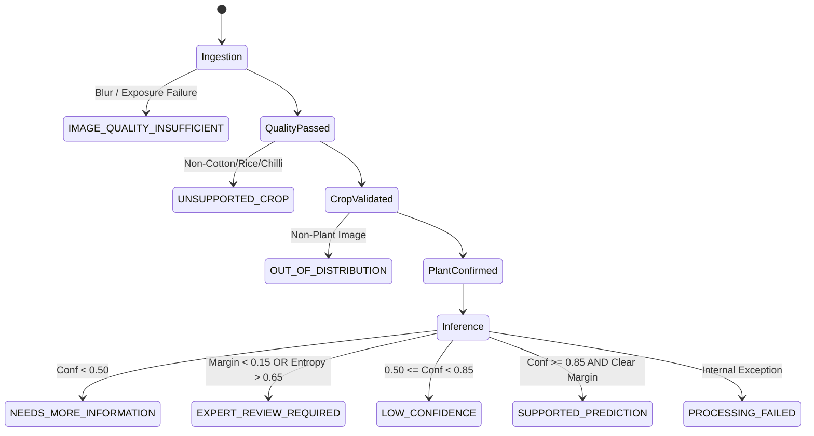

# KISANVISION — UNCERTAINTY & ABSTENTION STRATEGY

**Document Version:** 1.0.0  
**Effective Date:** November 7, 2026  
**Status:** Approved Research & Operational Policy  
**Scope:** Foliar Pathology AI Diagnostics across Cotton, Rice, and Chilli  

---

## 1. Executive Summary & Core Principle

In medical and agricultural AI systems, an uncalibrated overconfident prediction on a novel or ambiguous input causes severe real-world harm. In Telangana, a smallholder farmer acting on an erroneous high-confidence disease diagnosis may spend limited household savings on ineffective, unapproved chemical sprays while the actual pathogen destroys their crop.

**The Golden Principle of KisanVision:**
> *"An agricultural AI system must possess the humility to declare when an image is blurred, when a crop is unsupported, when symptoms are ambiguous, and when a human agronomist must take over."*

KisanVision explicitly decouples:
1. **Raw Model Score** (unbounded logit $z_i$).
2. **Calibrated Probability** ($p_i(T)$ scaled by temperature $T$).
3. **Prediction Uncertainty** (Normalized Shannon Entropy $\bar{H}$ and Margin $\Delta p$).
4. **Out-of-Distribution Status** (Vegetation Index $ExG$ and Embedding Anomaly).
5. **Image Quality Status** (Sharpness variance and Exposure clipping).
6. **Agricultural Decision State** (One of 8 deterministic decision states).

---

## 2. The Eight Agricultural Decision States

### State Definitions & Action Workflows:

| Decision State | Trigger Condition | System Action | Agricultural Workflow |
| :--- | :--- | :--- | :--- |
| **`SUPPORTED_PREDICTION`** | Conf $\ge 0.85$, $\bar{H} \le 0.65$, $\Delta p \ge 0.15$, Quality Passed. | Issue definitive diagnosis with localized Telugu/Hindi names. | Display CIBRC chemical advisory and PJTSAU agronomic management steps. |
| **`LOW_CONFIDENCE`** | $0.50 \le \text{Conf} < 0.85$, $\bar{H} \le 0.65$. | Issue preliminary diagnosis with differential ranking. | Warn farmer that confidence is moderate; recommend ground re-inspection. |
| **`EXPERT_REVIEW_REQUIRED`** | $\Delta p < 0.15$ OR $\bar{H} > 0.65$. | Suppress single-class recommendation; output top-3 differential suspects. | Auto-dispatch case to local Mandal Agricultural Officer / KVK agronomist. |
| **`NEEDS_MORE_INFORMATION`** | Conf $< 0.50$. | Abstain from chemical recommendations. | Prompt farmer for complementary context (growth stage, irrigation, symptoms). |
| **`IMAGE_QUALITY_INSUFFICIENT`** | Sharpness $< 40$ or extreme pixel clipping. | Reject image immediately without executing model. | Provide instant camera retake tips (distance, lighting, angle). |
| **`UNSUPPORTED_CROP`** | Crop not in `{cotton, rice, chilli}`. | Abstain from foliar pathology diagnosis. | Inform farmer of supported scope and log request for future expansion. |
| **`OUT_OF_DISTRIBUTION`** | Foliar pixel ratio $< 8\%$ or texture std $< 5.0$. | Reject input as non-plant. | Request clear photo of foliage. |
| **`PROCESSING_FAILED`** | Hardware/runtime memory exception. | Return sanitized RFC 7807 error payload. | Retry on failover instance and log alert to Sentry. |

---

## 3. Mathematical Formulation of Uncertainty Metrics

### 3.1 Normalized Shannon Entropy
Shannon entropy measures the dispersion of the probability distribution across all $C$ candidate classes:
$$H(p) = -\sum_{i=1}^C p_i \log_2(p_i + \epsilon)$$
Because $H(p)$ scales with the number of classes ($\max H = \log_2 C$), we normalize to the unit interval $[0, 1]$:
$$\bar{H}(p) = \frac{H(p)}{\log_2(C)}$$
- $\bar{H}(p) \approx 0.0$: Near-total certainty in a single class.
- $\bar{H}(p) > 0.65$: High symptomatic ambiguity (e.g. confusion between Bacterial Blight and Alternaria Leaf Spot). Triggers `EXPERT_REVIEW_REQUIRED`.

### 3.2 Prediction Margin
The difference between the top probability and the runner-up:
$$\Delta p = p_{(1)} - p_{(2)}$$
When $\Delta p < 0.15$, the model cannot reliably separate the primary suspect from the differential alternative. The system must never make an autonomous unilateral treatment recommendation in this regime.

---

## 4. Temperature-Scaled Probability Calibration

Raw softmax outputs $p_i = \frac{e^{z_i}}{\sum_j e^{z_j}}$ are notoriously overconfident in modern neural networks. KisanVision applies post-hoc temperature scaling:
$$\hat{p}_i = \frac{\exp(z_i / T)}{\sum_{j=1}^C \exp(z_j / T)}$$
- The scalar temperature $T > 0$ is fitted exclusively on **held-out validation sets** by minimizing Negative Log Likelihood (NLL).
- Fitting on the test set is strictly prohibited to prevent data leakage.
- Temperature scaling softens extreme probabilities while keeping top-1 classification predictions 100% identical.
