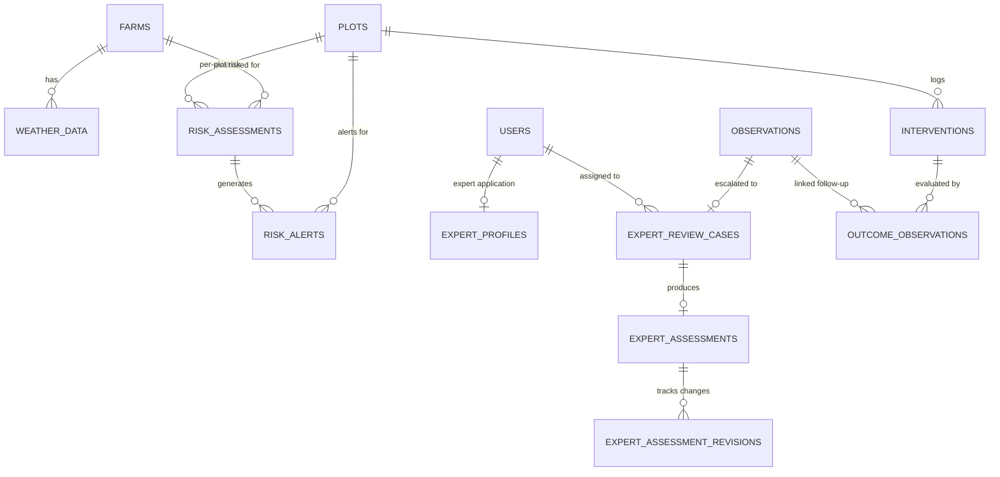

# ACREVIA — Stage 7 Database & Domain Model Specification
## Entity Relational Design, Indexes, Constraints & Multi-Tenant Isolation

---

## 1. Domain Boundary Architecture

Stage 7 introduces eight core models organized into three coherent domain clusters:
1. **RiskCast Cluster:** `WeatherData`, `RiskRule`, `RiskAssessmentRecord`, `RiskAlert`.
2. **ExpertConnect Cluster:** `ExpertProfile`, `ExpertReviewCase`, `ExpertAssessment`, `ExpertAssessmentRevision`.
3. **Intervention Cluster:** `InterventionRecord`, `OutcomeObservation`.

All entities enforce strict relational integrity, foreign keys with appropriate cascade rules, and tenant boundary verification via `farm_id` and `plot_id`.

---

## 2. Table Specifications

### 2.1 RiskCast Cluster

#### `weather_data`
- `id` (VARCHAR(36), PK)
- `farm_id` (VARCHAR(36), FK -> `farms.id`, ON DELETE CASCADE, Indexed)
- `district` (VARCHAR(50), Indexed)
- `is_forecast` (BOOLEAN, default False, Indexed)
- `observation_time` (TIMESTAMP WITH TIME ZONE, Indexed)
- `forecast_target_time` (TIMESTAMP WITH TIME ZONE, nullable, Indexed)
- `temperature_celsius` (FLOAT)
- `relative_humidity` (FLOAT)
- `precipitation_mm` (FLOAT)
- `wind_speed_kmh` (FLOAT)
- `leaf_wetness_hours` (FLOAT, default 0.0)
- `source_provider` (VARCHAR(50), default "Open-Meteo")
- `created_at` (TIMESTAMP WITH TIME ZONE)

#### `risk_rules`
- `id` (VARCHAR(36), PK)
- `rule_code` (VARCHAR(50), Unique, Indexed)
- `crop` (VARCHAR(50), Indexed) — COTTON, RICE, CHILLI
- `target_threat` (VARCHAR(100), Indexed)
- `applicable_growth_stages` (VARCHAR(255)) — Comma-separated or JSON
- `min_temp` (FLOAT, nullable)
- `max_temp` (FLOAT, nullable)
- `min_humidity` (FLOAT, nullable)
- `min_leaf_wetness_hours` (FLOAT, nullable)
- `min_consecutive_wet_days` (INTEGER, nullable)
- `severity_level` (VARCHAR(20)) — LOW, MODERATE, HIGH
- `advisory_en` (TEXT)
- `advisory_te` (TEXT)
- `advisory_hi` (TEXT)
- `evidence_citations_json` (TEXT)
- `version` (VARCHAR(20), default "1.0")
- `is_active` (BOOLEAN, default True, Indexed)

#### `risk_assessment_records`
- `id` (VARCHAR(36), PK)
- `plot_id` (VARCHAR(36), FK -> `plots.id`, ON DELETE CASCADE, Indexed)
- `farm_id` (VARCHAR(36), FK -> `farms.id`, ON DELETE CASCADE, Indexed)
- `crop_season_id` (VARCHAR(36), FK -> `crop_seasons.id`, ON DELETE SET NULL, nullable)
- `evaluation_timestamp` (TIMESTAMP WITH TIME ZONE, Indexed)
- `overall_risk_level` (VARCHAR(20), Indexed) — LOW, MODERATE, HIGH, INSUFFICIENT_DATA
- `weather_data_id` (VARCHAR(36), FK -> `weather_data.id`, ON DELETE SET NULL, nullable)
- `rules_triggered_json` (TEXT)
- `advisory_en` (TEXT)
- `advisory_te` (TEXT)
- `advisory_hi` (TEXT)
- `limitations_notice` (TEXT)

#### `risk_alerts`
- `id` (VARCHAR(36), PK)
- `farm_id` (VARCHAR(36), FK -> `farms.id`, ON DELETE CASCADE, Indexed)
- `plot_id` (VARCHAR(36), FK -> `plots.id`, ON DELETE CASCADE, Indexed)
- `risk_assessment_id` (VARCHAR(36), FK -> `risk_assessment_records.id`, ON DELETE CASCADE, Indexed)
- `alert_level` (VARCHAR(20), Indexed) — LOW, MODERATE, HIGH
- `title` (VARCHAR(150))
- `message_en` (TEXT)
- `message_te` (TEXT)
- `message_hi` (TEXT)
- `recommended_actions_json` (TEXT)
- `is_acknowledged` (BOOLEAN, default False, Indexed)
- `acknowledged_at` (TIMESTAMP WITH TIME ZONE, nullable)
- `is_dismissed` (BOOLEAN, default False, Indexed)
- `dismissed_at` (TIMESTAMP WITH TIME ZONE, nullable)
- `deduplication_key` (VARCHAR(128), Indexed)
- `created_at` (TIMESTAMP WITH TIME ZONE, Indexed)

---

### 2.2 ExpertConnect Cluster

#### `expert_profiles`
- `id` (VARCHAR(36), PK)
- `user_id` (VARCHAR(36), FK -> `users.id`, ON DELETE CASCADE, Unique, Indexed)
- `registration_number` (VARCHAR(100), Unique, nullable)
- `highest_degree` (VARCHAR(100))
- `institution` (VARCHAR(150))
- `specializations_json` (VARCHAR(500))  # e.g., ["COTTON", "RICE", "CHILLI"]
- `districts_covered_json` (VARCHAR(500)) # e.g., ["Warangal", "Khammam"]
- `verification_status` (VARCHAR(50), default "APPLICATION_SUBMITTED", Indexed)
- `verified_by_user_id` (VARCHAR(36), FK -> `users.id`, ON DELETE SET NULL, nullable)
- `verified_at` (TIMESTAMP WITH TIME ZONE, nullable)
- `rejection_reason` (TEXT, nullable)

#### `expert_review_cases`
- `id` (VARCHAR(36), PK)
- `diagnosis_request_id` (VARCHAR(36), FK -> `diagnosis_requests.id`, ON DELETE CASCADE, nullable, Indexed)
- `observation_id` (VARCHAR(36), FK -> `observations.id`, ON DELETE CASCADE, Indexed)
- `farm_id` (VARCHAR(36), FK -> `farms.id`, ON DELETE CASCADE, Indexed)
- `plot_id` (VARCHAR(36), FK -> `plots.id`, ON DELETE SET NULL, nullable)
- `crop_id` (VARCHAR(50), Indexed)
- `priority` (VARCHAR(20), default "ROUTINE", Indexed) # ROUTINE, URGENT
- `status` (VARCHAR(50), default "QUEUED", Indexed) # QUEUED, ASSIGNED, IN_REVIEW, COMPLETED, ESCALATED
- `assigned_expert_id` (VARCHAR(36), FK -> `users.id`, ON DELETE SET NULL, nullable, Indexed)
- `assigned_at` (TIMESTAMP WITH TIME ZONE, nullable)
- `completed_at` (TIMESTAMP WITH TIME ZONE, nullable)

#### `expert_assessments`
- `id` (VARCHAR(36), PK)
- `case_id` (VARCHAR(36), FK -> `expert_review_cases.id`, ON DELETE CASCADE, Unique, Indexed)
- `expert_id` (VARCHAR(36), FK -> `users.id`, ON DELETE RESTRICT, Indexed)
- `confirmed_crop` (VARCHAR(50), nullable=False)
- `primary_condition` (VARCHAR(100), nullable=False)
- `differential_diagnoses_json` (TEXT, nullable)
- `confidence_rating` (INTEGER, nullable=False) # 1 to 5
- `urgency_level` (VARCHAR(20), default "ROUTINE", nullable=False)
- `management_plan` (TEXT, nullable=False)
- `ipm_strategy` (TEXT, nullable=False)
- `cibrc_advisories` (TEXT, nullable=False)
- `revision_count` (INTEGER, default=0, nullable=False)
- `created_at` (TIMESTAMP WITH TIME ZONE)
- `updated_at` (TIMESTAMP WITH TIME ZONE)

#### `expert_assessment_revisions`
- `id` (VARCHAR(36), PK)
- `assessment_id` (VARCHAR(36), FK -> `expert_assessments.id`, ON DELETE CASCADE, Indexed)
- `revision_number` (INTEGER, nullable=False)
- `previous_assessment_json` (TEXT, nullable=False)
- `revision_reason` (TEXT, nullable=False)
- `revised_by_user_id` (VARCHAR(36), FK -> `users.id`, ON DELETE RESTRICT, nullable=False)
- `revised_at` (TIMESTAMP WITH TIME ZONE, nullable=False)

---

### 2.3 Intervention Cluster

#### `intervention_records`
- `id` (VARCHAR(36), PK)
- `plot_id` (VARCHAR(36), FK -> `plots.id`, ON DELETE CASCADE, Indexed)
- `farm_id` (VARCHAR(36), FK -> `farms.id`, ON DELETE CASCADE, Indexed)
- `farmer_id` (VARCHAR(36), FK -> `users.id`, ON DELETE RESTRICT, Indexed)
- `category` (VARCHAR(50), nullable=False, Indexed) # BIOLOGICAL, CHEMICAL, CULTURAL, IRRIGATION, FERTILIZER
- `trade_name` (VARCHAR(150), nullable=False)
- `active_ingredient` (VARCHAR(150), nullable=True)
- `dosage` (FLOAT, nullable=False)
- `unit` (VARCHAR(30), default="ml/acre", nullable=False) # ml/acre, g/acre, kg/acre, litres
- `application_method` (VARCHAR(100), nullable=False) # FOLIAR_SPRAY, SOIL_DRENCH, SEED_TREATMENT, TRAP
- `application_date` (DATE, nullable=False, Indexed)
- `target_condition` (VARCHAR(100), nullable=True)
- `phi_days` (INTEGER, default=0, nullable=False) # Pre-harvest interval
- `rei_hours` (INTEGER, default=24, nullable=False) # Re-entry interval
- `notes` (TEXT, nullable=True)

#### `outcome_observations`
- `id` (VARCHAR(36), PK)
- `intervention_id` (VARCHAR(36), FK -> `intervention_records.id`, ON DELETE CASCADE, Indexed)
- `follow_up_observation_id` (VARCHAR(36), FK -> `observations.id`, ON DELETE CASCADE, Indexed)
- `evaluation_date` (DATE, nullable=False)
- `observed_status` (VARCHAR(50), nullable=False, Indexed) # IMPROVING, STABLE, WORSENING, INCONCLUSIVE
- `visual_change_notes` (TEXT, nullable=False)
- `confounding_factors` (TEXT, nullable=False)
- `farmer_assessment` (TEXT, nullable=True)
- `days_post_intervention` (INTEGER, nullable=False)
