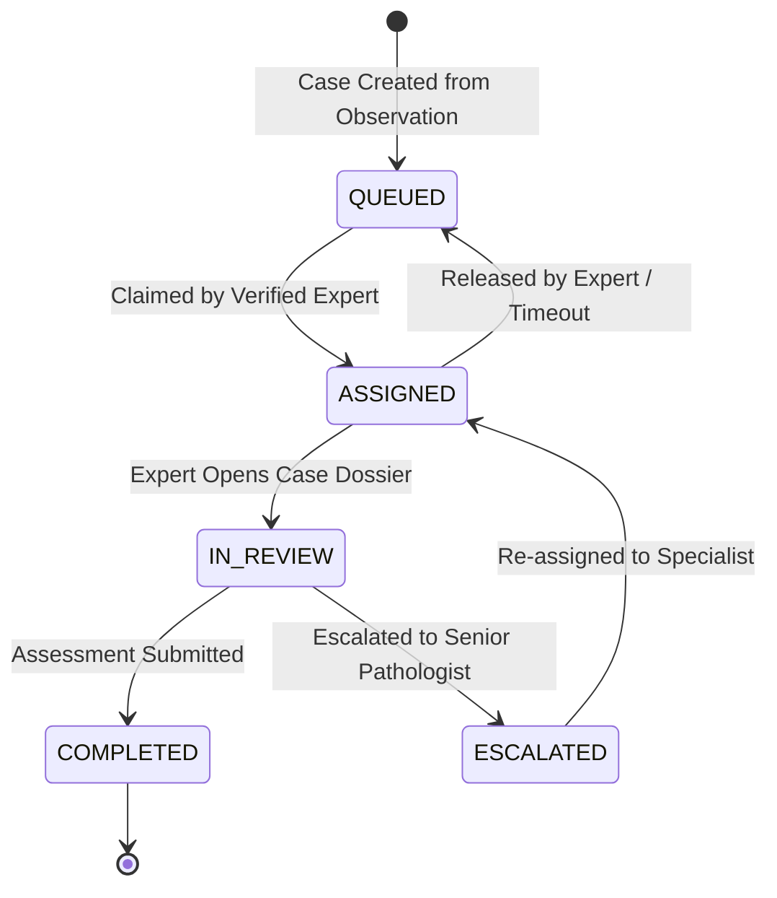

# ACREVIA — ExpertConnect Architecture Specification
## Human Agricultural Expert Review Network & Clinical Case Management

---

## 1. System Vision & Objective

ExpertConnect bridges automated AI inference and certified human agronomists. It operates as an asynchronous, clinical-grade consultation and review platform tailored for agricultural extension officers, PJTSAU university scientists, and accredited crop specialists.

```
+-----------------------------------------------------------------------------------+
|                           FARMER / AI ESCALATION INITIATION                       |
|   - CropPulse Observation with High Entropy / Narrow Decision Margin              |
|   - Out-of-Distribution or Low Confidence Vision Inference                        |
|   - Farmer Manual Request for Agronomist Opinion                                  |
+-----------------------------------------+-----------------------------------------+
                                          |
                                          v
+-----------------------------------------------------------------------------------+
|                             EXPERT REVIEW CASE DOSSIER                            |
|   +---------------------------------------------------------------------------+   |
|   | 1. High-Resolution Foliar Imagery & Quality Score (Sharpness/Exposure)    |   |
|   | 2. Farm & Plot Metadata: Crop, Variety, Sowing Date, Growth Stage, Soil   |   |
|   | 3. CropVision Model Prediction: Decision State, Probabilities, Entropy    |   |
|   | 4. KrishiBrain Knowledge Retrieval: ICAR/PJTSAU Extracted Citations       |   |
|   | 5. RiskCast Agrometeorological Context: Recent Temp, RH, Rainfall         |   |
|   +---------------------------------------------------------------------------+   |
+-----------------------------------------+-----------------------------------------+
                                          |
                                          v
+-----------------------------------------------------------------------------------+
|                        TRIAGE QUEUE & WORKSPACE FOR EXPERTS                       |
|   - Filter by Crop Specialization (Cotton, Rice, Chilli) & District               |
|   - Priority Queuing (URGENT vs. ROUTINE)                                         |
|   - Atomic Case Claiming (Prevents collision between agronomists)                 |
+-----------------------------------------+-----------------------------------------+
                                          |
                                          v
+-----------------------------------------------------------------------------------+
|                           CERTIFIED EXPERT ASSESSMENT                             |
|   - Confirmed Crop & Verified Biological Condition (or Multiple Differentials)    |
|   - Expert Confidence Rating (1 to 5) & Urgency Grade                             |
|   - IPM Action Plan: Cultural & Biological Controls First; CIBRC Chemical as Last |
|   - Immutable Versioning (Revisions preserve complete audit diff & reason)        |
+-----------------------------------------+-----------------------------------------+
                                          |
                                          v
+-----------------------------------------------------------------------------------+
|                                 FARMER DELIVERY                                   |
|   - Push Notification & In-App Dossier Update                                     |
|   - Rendered in Farmer's Preferred Language (Telugu, English, Hindi)              |
|   - Traceable Agronomist Credentials Displayed for Trust & Accountability         |
+-----------------------------------------------------------------------------------+
```

---

## 2. Core Architectural Safeguards

### 2.1 The AI-Isolation Barrier
- **Decision Independence:** The AI's vision output is presented as one piece of evidence alongside images and weather history. The agronomist is explicitly instructed to examine foliar patterns independently.
- **No Direct ML Loop Feedback:** An expert confirmation or override is **never** automatically injected into production ML weights or retraining sets. Retraining data must pass through an independent dataset curation and de-duplication pipeline to prevent human-in-the-loop confirmation bias.

### 2.2 Case State Machine & Triage Workflow



- `QUEUED`: Case is in the unassigned pool, visible to experts certified in the respective crop/district.
- `ASSIGNED`: An expert has claimed the case. Bounded claiming lease prevents stagnant abandonment.
- `IN_REVIEW`: Expert is actively reviewing images, context, and formulating the diagnostic report.
- `COMPLETED`: A structured `ExpertAssessment` has been finalized and dispatched to the farmer.
- `ESCALATED`: Expert encounters a rare pathogen, complex abiotic-biotic interaction, or quarantine-level pest, routing the case to a senior research pathologist.

### 2.3 Immutable Revision Architecture
- Once submitted, an `ExpertAssessment` cannot be destructively updated.
- If new information arises (e.g., follow-up image or laboratory soil test), the expert submits a revision.
- A new `ExpertAssessmentRevision` record is created containing the prior snapshot, the updated fields, the revision rationale, and the timestamp.
- The farmer interface displays the current active assessment with a clear "Revised on [Date]" badge and access to revision notes.
