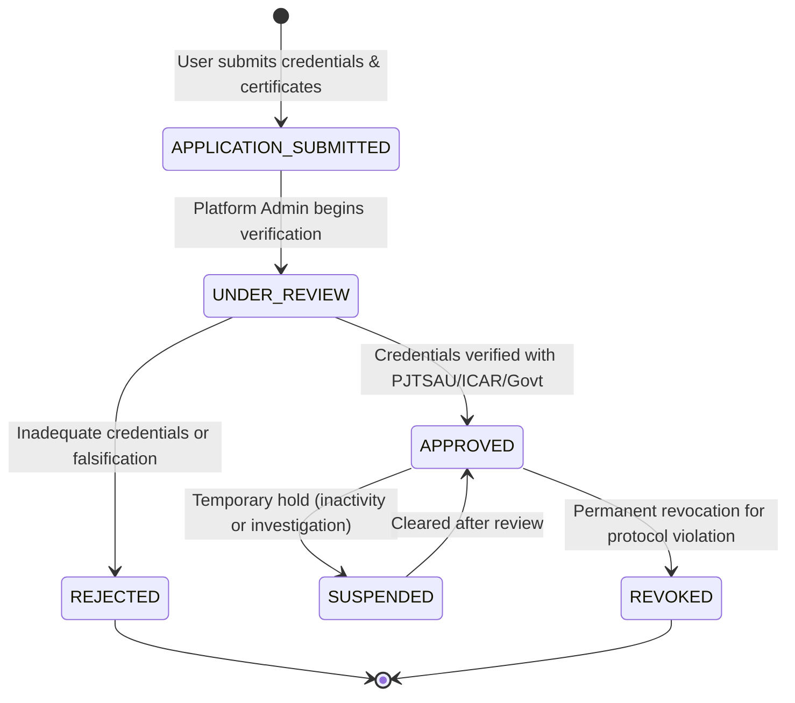

# ACREVIA — Agricultural Expert Verification & Governance Framework
## Credentialing Lifecycle, Trust Architecture & Audit Trails

---

## 1. Problem Statement & Anti-Patterns Avoided

In many generic tele-consultation apps, any registered user can self-declare as an "expert" or "doctor" by toggling a dropdown menu during registration. In agriculture, erroneous pesticide or fungicide advice from an unqualified user can lead to severe crop failure, soil degradation, high debt, or pesticide poisoning.

ACREVIA establishes a rigorous, audited credentialing lifecycle.

---

## 2. Expert Lifecycle State Machine

1. **`APPLICATION_SUBMITTED`:**
   - Candidate registers and supplies:
     - Full Legal Name & Government ID reference.
     - Highest Agronomic Degree (e.g., B.Sc. / M.Sc. / Ph.D. in Agriculture, Agronomy, Entomology, or Plant Pathology).
     - Affiliated Institution / University (e.g., PJTSAU, ICAR-CRIDA, KVK Warangal).
     - Professional Registration / Employee Number.
     - Crop Specializations (Cotton, Rice, Chilli).
     - Districts of Active Field Experience in Telangana.
   - User does **not** gain `AGRICULTURAL_EXPERT` role permissions at this stage.
2. **`UNDER_REVIEW`:**
   - Platform Administrator reviews submitted proof documents against state agricultural rosters and university registries.
3. **`APPROVED`:**
   - Admin approves profile. System automatically grants `AGRICULTURAL_EXPERT` role and sets `verified_at` timestamp.
   - User receives access to `/expert` portal, the case triage queue, and diagnostic review tools.
4. **`SUSPENDED` / `REVOKED`:**
   - If an expert issues advice violating CIBRC banned pesticide regulations or exhibits non-professional behavior, admin immediately suspends or permanently revokes permissions.

---

## 3. Agronomic Ethics & CIBRC Chemical Guardrails

Every expert operating on ACREVIA signs an ethical agreement adhering to:
1. **Integrated Pest Management (IPM) First:** Cultural, mechanical, and biological measures must be prioritized over synthetic chemical spraying whenever pest populations are below the Economic Threshold Level (ETL).
2. **CIBRC Compliance:** Experts are strictly forbidden from recommending banned pesticides (e.g., Monocrotophos on vegetables, Endosulfan, Paraquat Dichoride without proper personal protective equipment (PPE) mandates).
3. **Pre-Harvest Intervals (PHI):** Any chemical recommendation must explicitly state the mandatory waiting period before harvest to prevent hazardous residues in food crops.
4. **Traceable Attribution:** Every assessment displays the reviewing expert's verified name, degree, and institution to the farmer.
