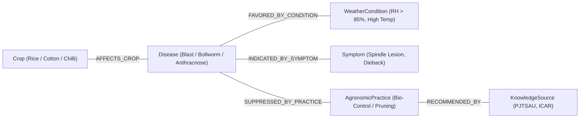

# ACREVIA — AGRICULTURAL KNOWLEDGE GRAPH
## Domain Ontology, Structured Relational Adjacency & Hybrid KrishiBrain Retrieval

---

## 1. Overview & Architectural Intent
While vector embeddings in KrishiBrain excel at semantic passage retrieval, complex agricultural decision-making requires explicit causal and ontological structures:
- A farmer's rice field faces 88% humidity and 23°C night temperatures.
- Vector search retrieves isolated documents about paddy diseases.
- The **Agricultural Knowledge Graph** traverses the explicit path:
  `Rice [Crop]` $\xleftarrow{\text{AFFECTS}}$ `Rice Blast [Disease]` $\xrightarrow{\text{FAVORED\_BY}}$ `High Humidity (>85%) [WeatherCondition]` $\xrightarrow{\text{FAVORED\_BY}}$ `Leaf Wetness > 10h [EnvironmentalFactor]` $\xrightarrow{\text{SUPPRESSED\_BY}}$ `Tricyclazole 75% WP [ChemicalIntervention]` and `Pseudomonas fluorescens [BioControl]`.



---

## 2. Knowledge Graph Entities & Relations Taxonomy

### 2.1 Entity Classes
- `Crop`: Taxonomically classified agricultural cultivars (Cotton, Rice, Chilli).
- `Disease`: Pathogenic agents (fungal, bacterial, viral).
- `Pest`: Insect pests (Pink Bollworm, Brown Planthopper, Thrips, Aphids).
- `WeatherCondition`: Environmental thresholds (High Humidity, Waterlogging, Heat Shock, Prolonged Dew).
- `SoilType`: Soil substrate profiles (Black Cotton Vertisol, Red Chalka, Alluvial).
- `AgronomicPractice`: Recommended cultural, biological, and chemical interventions.
- `Symptom`: Morphological and visual indicators observed on foliage, bolls, stems, or roots.

### 2.2 Relational Edges
- `AFFECTS_CROP`
- `FAVORED_BY_CONDITION`
- `INDICATED_BY_SYMPTOM`
- `SUPPRESSED_BY_PRACTICE`
- `REQUIRES_SOIL`
- `INTERACTS_WITH`

---

## 3. Database Schema Implementation in Neon PostgreSQL

The Knowledge Graph is implemented using indexed relational adjacency tables optimized for sub-millisecond multi-hop recursive Common Table Expressions (CTEs):

```sql
CREATE TABLE knowledge_entities (
    id VARCHAR(36) PRIMARY KEY,
    entity_type VARCHAR(50) NOT NULL, -- CROP, DISEASE, PEST, WEATHER_CONDITION, PRACTICE, SYMPTOM
    canonical_name VARCHAR(150) NOT NULL,
    local_name_te VARCHAR(150),
    local_name_hi VARCHAR(150),
    scientific_name VARCHAR(150),
    properties_json JSONB DEFAULT '{}'::jsonb,
    created_at TIMESTAMP WITH TIME ZONE DEFAULT CURRENT_TIMESTAMP
);

CREATE TABLE knowledge_relationships (
    id VARCHAR(36) PRIMARY KEY,
    source_entity_id VARCHAR(36) REFERENCES knowledge_entities(id) ON DELETE CASCADE,
    target_entity_id VARCHAR(36) REFERENCES knowledge_entities(id) ON DELETE CASCADE,
    relationship_type VARCHAR(50) NOT NULL, -- AFFECTS_CROP, FAVORED_BY_CONDITION, SUPPRESSED_BY_PRACTICE, etc.
    confidence_weight FLOAT DEFAULT 1.0,
    evidence_source VARCHAR(200) NOT NULL, -- PJTSAU Advisory / ICAR Pop
    properties_json JSONB DEFAULT '{}'::jsonb,
    created_at TIMESTAMP WITH TIME ZONE DEFAULT CURRENT_TIMESTAMP
);

CREATE INDEX ix_kg_rel_source ON knowledge_relationships(source_entity_id, relationship_type);
CREATE INDEX ix_kg_rel_target ON knowledge_relationships(target_entity_id, relationship_type);
```

---

## 4. Graph Traversal Service & KrishiBrain Augmentation

When a user query arrives or RiskCast runs an evaluation:
1. **Entity Extraction:** Map input keywords or diagnosis classifications to graph entities (e.g., `Crop: Chilli`, `Weather: High Humidity`).
2. **Neighbor Expansion (2-hop traversal):** Retrieve all associated pathogens, susceptible crop growth stages, and official PJTSAU package of practices.
3. **Structured Context Injection:** Append graph facts directly into the prompt template fed to KrishiBrain RAG, guaranteeing factual grounding and eliminating hallucinations.
