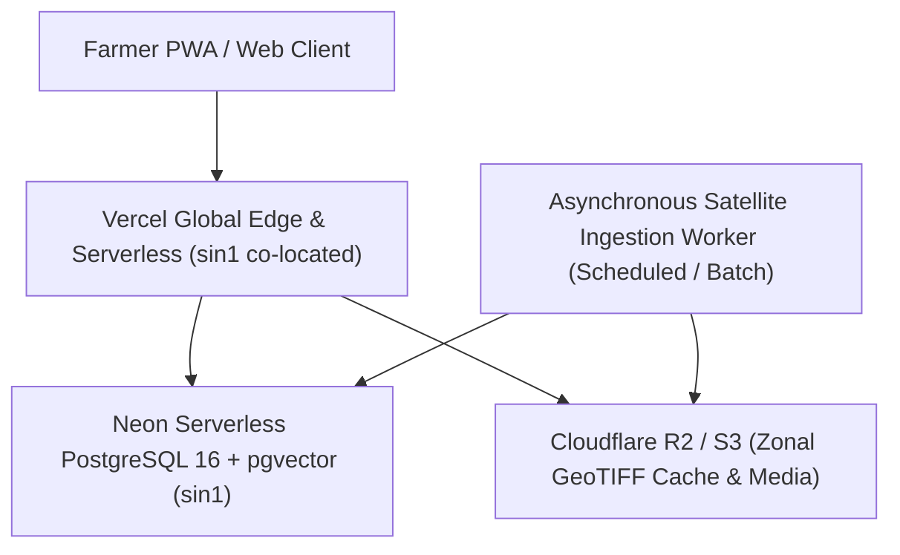

# ACREVIA — COST AND SCALABILITY REPORT
## Infrastructure Sizing, Compute Allocation & Operational Budget for Phase II

---

## 1. Cloud Infrastructure Architecture

- **Database:** Single primary Neon PostgreSQL 16 in Singapore (`sin1`), shared with pgvector.
- **Frontend & APIs:** Next.js App Router deployed on Vercel Edge/Serverless in `sin1`.
- **Heavy Raster Ingestion:** Async batch workers externalized from Vercel Functions to prevent execution timeouts (10s/15s limits).

---

## 2. Resource Consumption & Cost Projections (10,000 Active Smallholder Plots)

| Service Component | Operational Unit | Monthly Usage | Unit Cost | Projected Monthly Cost |
|---|---|---|---|---|
| **Vercel Pro Tier** | Team seats + Edge Requests | 10M invocations | Flat + \$2.00/M overage | ~\$40.00 |
| **Neon PostgreSQL** | Compute (0.25 to 2 CU auto-scaling) + Storage | ~25 GB + 150 CU-hours | Compute: \$0.16/CU-hr, Storage: \$0.000164/GB-hr | ~\$55.00 |
| **Cloudflare R2 Object Storage** | Zonal GeoTIFF Cache & Observation Media | 250 GB stored, 500k class A operations | \$0.015/GB-mo (Zero egress fee) | ~\$4.50 |
| **Sentinel-2 Data (CDSE / AWS)** | Open Data Access | 150 GB downloaded | Free (CC BY-SA) | \$0.00 |
| **Total Estimated Run-Rate** | **10,000 Plots in Telangana** | — | — | **~\$99.50 / month** |

### Cost per Plot per Month:
$$\frac{\$99.50}{10,000 \text{ plots}} \approx \$0.010 \text{ (approx. ₹0.85 INR per plot/month)}$$
This ultra-efficient architecture ensures long-term economic sustainability for Indian agricultural cooperatives and extension programs.
