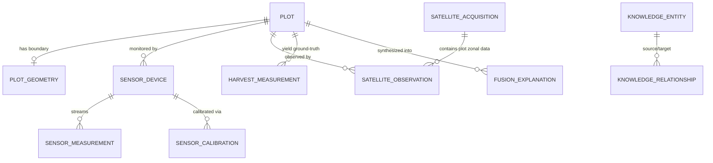

# ACREVIA — DATABASE DESIGN SPECIFICATION
## Phase II Neon PostgreSQL Schema for Precision Agriculture, Satellite, IoT, Evidence Fusion & Knowledge Graph

---

## 1. Overview & Storage Engine
All Stage 09 precision agriculture entities reside within the single canonical **Neon PostgreSQL 16** instance in Singapore (`sin1`), alongside pgvector. 

No auxiliary relational databases or external unmanaged storage systems are introduced. Large multi-spectral raster layers are referenced via cloud object storage URIs (S3/R2), with spatial polygons, telemetry points, and graph relationships indexed directly in PostgreSQL.

---

## 2. Table Schemas & Domain Definitions

### 2.1 Geospatial Domain (`Acrevia Geo`)
- **`plot_geometries`**:
  - `id` (VARCHAR(36) PK)
  - `plot_id` (VARCHAR(36) FK -> plots.id ON DELETE CASCADE, UNIQUE)
  - `geometry_type` (VARCHAR(30) DEFAULT 'Polygon')
  - `coordinates_geojson` (TEXT NOT NULL) — Strict GeoJSON linear ring
  - `centroid_lat` (FLOAT NOT NULL), `centroid_lon` (FLOAT NOT NULL)
  - `calculated_area_hectares` (FLOAT NOT NULL)
  - `bbox_min_lon` (FLOAT), `bbox_min_lat` (FLOAT), `bbox_max_lon` (FLOAT), `bbox_max_lat` (FLOAT)
  - `created_at`, `updated_at` (TIMESTAMP WITH TIME ZONE)

- **`location_permissions`**:
  - `id` (VARCHAR(36) PK)
  - `farm_id` (VARCHAR(36) FK -> farms.id ON DELETE CASCADE)
  - `user_id` (VARCHAR(36) FK -> users.id ON DELETE CASCADE)
  - `granularity` (VARCHAR(30) DEFAULT 'EXACT_BOUNDARY') -- EXACT_BOUNDARY, COARSE_VILLAGE, REVOKED
  - `consent_timestamp` (TIMESTAMP WITH TIME ZONE)
  - `is_active` (BOOLEAN DEFAULT TRUE)

### 2.2 Satellite Domain (`Acrevia Earth`)
- **`satellite_sources`**:
  - `id` (VARCHAR(36) PK)
  - `name` (VARCHAR(50) NOT NULL) -- SENTINEL_2, LANDSAT_9
  - `constellation` (VARCHAR(50) NOT NULL)
  - `spatial_resolution_meters` (FLOAT NOT NULL) -- 10.0, 30.0

- **`satellite_acquisitions`**:
  - `id` (VARCHAR(36) PK)
  - `source_id` (VARCHAR(36) FK -> satellite_sources.id)
  - `scene_id` (VARCHAR(100) UNIQUE NOT NULL)
  - `acquisition_date` (TIMESTAMP WITH TIME ZONE NOT NULL)
  - `cloud_coverage_percentage` (FLOAT NOT NULL)
  - `raw_metadata_json` (JSONB DEFAULT '{}'::jsonb)

- **`satellite_observations`**:
  - `id` (VARCHAR(36) PK)
  - `plot_id` (VARCHAR(36) FK -> plots.id ON DELETE CASCADE)
  - `acquisition_id` (VARCHAR(36) FK -> satellite_acquisitions.id)
  - `observation_date` (TIMESTAMP WITH TIME ZONE NOT NULL)
  - `mean_ndvi` (FLOAT), `min_ndvi` (FLOAT), `max_ndvi` (FLOAT), `std_ndvi` (FLOAT)
  - `mean_evi` (FLOAT), `mean_ndmi` (FLOAT)
  - `cloud_masked_pixel_ratio` (FLOAT NOT NULL)
  - `trend_classification` (VARCHAR(50)) -- VIGOR_INCREASING, STABLE, DECLINING_STRESS, HARVEST_CLEARING
  - `evidence_disclaimer` (TEXT NOT NULL) -- Mandatory non-disease disclaimer

### 2.3 Sensor & IoT Domain (`Acrevia Sense`)
- **`sensor_devices`**:
  - `id` (VARCHAR(36) PK)
  - `farm_id` (VARCHAR(36) FK -> farms.id ON DELETE CASCADE)
  - `plot_id` (VARCHAR(36) FK -> plots.id ON DELETE SET NULL)
  - `device_serial_number` (VARCHAR(100) UNIQUE NOT NULL)
  - `device_category` (VARCHAR(50) NOT NULL) -- SOIL_PROBE, WEATHER_STATION, LEAF_WETNESS, NPK_PROBE
  - `auth_token_hash` (VARCHAR(128) NOT NULL)
  - `firmware_version` (VARCHAR(50))
  - `status` (VARCHAR(30) DEFAULT 'ACTIVE') -- ACTIVE, INACTIVE, DECOMMISSIONED, ERROR
  - `last_heartbeat_at` (TIMESTAMP WITH TIME ZONE)

- **`sensor_measurements`**:
  - `id` (VARCHAR(36) PK)
  - `device_id` (VARCHAR(36) FK -> sensor_devices.id ON DELETE CASCADE)
  - `plot_id` (VARCHAR(36) FK -> plots.id ON DELETE CASCADE)
  - `timestamp` (TIMESTAMP WITH TIME ZONE NOT NULL)
  - `soil_moisture_pct` (FLOAT), `soil_temperature_c` (FLOAT)
  - `ambient_temperature_c` (FLOAT), `relative_humidity_pct` (FLOAT)
  - `leaf_wetness_pct` (FLOAT), `solar_radiation_w_m2` (FLOAT)
  - `battery_pct` (FLOAT), `signal_rssi` (INTEGER)
  - `data_quality_flag` (VARCHAR(50) DEFAULT 'VALID') -- VALID, SUSPECT_STUCK, SUSPECT_SPIKE, UNCALIBRATED, OUT_OF_BOUNDS

- **`sensor_calibrations`**:
  - `id` (VARCHAR(36) PK)
  - `device_id` (VARCHAR(36) FK -> sensor_devices.id ON DELETE CASCADE)
  - `calibrated_at` (TIMESTAMP WITH TIME ZONE NOT NULL)
  - `valid_until` (TIMESTAMP WITH TIME ZONE NOT NULL)
  - `calibrated_by` (VARCHAR(100) NOT NULL)
  - `calibration_coefficients_json` (JSONB DEFAULT '{}'::jsonb)
  - `is_valid` (BOOLEAN DEFAULT TRUE)

### 2.4 Evidence Fusion Domain (`Acrevia Fusion`)
- **`fusion_explanations`**:
  - `id` (VARCHAR(36) PK)
  - `plot_id` (VARCHAR(36) FK -> plots.id ON DELETE CASCADE)
  - `evaluation_timestamp` (TIMESTAMP WITH TIME ZONE NOT NULL)
  - `overall_vigor_status` (VARCHAR(50) NOT NULL)
  - `primary_stress_driver` (VARCHAR(50) NOT NULL) -- MOISTURE_DEFICIT, WATERLOGGING, HEAT_STRESS, PEST_DISEASE_SUSPECT, OPERATIONAL_CLEARING
  - `evidence_sources_json` (JSONB NOT NULL)
  - `contradictions_detected_json` (JSONB DEFAULT '[]'::jsonb)
  - `farmer_explanation_en` (TEXT NOT NULL)
  - `farmer_explanation_te` (TEXT NOT NULL)
  - `farmer_explanation_hi` (TEXT NOT NULL)
  - `epistemic_qualifications_json` (JSONB NOT NULL)

### 2.5 Yield Feasibility Domain (`Acrevia Predict`)
- **`harvest_measurements`**:
  - `id` (VARCHAR(36) PK)
  - `plot_id` (VARCHAR(36) FK -> plots.id ON DELETE CASCADE)
  - `season_id` (VARCHAR(36) FK -> crop_seasons.id ON DELETE CASCADE)
  - `harvest_date` (TIMESTAMP WITH TIME ZONE NOT NULL)
  - `yield_quintals_per_acre` (FLOAT NOT NULL)
  - `total_harvest_kg` (FLOAT NOT NULL)
  - `provenance_tier` (VARCHAR(30) NOT NULL) -- TIER_1_VERIFIED_WEIGHBRIDGE, TIER_2_CCE_CUT, TIER_3_FARMER_REPORT
  - `verification_document_url` (VARCHAR(500))

- **`yield_forecast_records`**:
  - `id` (VARCHAR(36) PK)
  - `plot_id` (VARCHAR(36) FK -> plots.id ON DELETE CASCADE)
  - `season_id` (VARCHAR(36) FK -> crop_seasons.id ON DELETE CASCADE)
  - `model_version` (VARCHAR(50) NOT NULL)
  - `status` (VARCHAR(50) NOT NULL) -- WITHHELD_INSUFFICIENT_DATA, READY_FOR_PILOT, RESEARCH_ONLY
  - `predicted_yield_min` (FLOAT), `predicted_yield_max` (FLOAT)
  - `confidence_score` (FLOAT)
  - `withholding_reason` (TEXT)

### 2.6 Knowledge Graph Domain
- **`knowledge_entities`**:
  - `id` (VARCHAR(36) PK)
  - `entity_type` (VARCHAR(50) NOT NULL)
  - `canonical_name` (VARCHAR(150) NOT NULL)
  - `local_name_te` (VARCHAR(150)), `local_name_hi` (VARCHAR(150))
  - `scientific_name` (VARCHAR(150))
  - `properties_json` (JSONB DEFAULT '{}'::jsonb)

- **`knowledge_relationships`**:
  - `id` (VARCHAR(36) PK)
  - `source_entity_id` (VARCHAR(36) FK -> knowledge_entities.id ON DELETE CASCADE)
  - `target_entity_id` (VARCHAR(36) FK -> knowledge_entities.id ON DELETE CASCADE)
  - `relationship_type` (VARCHAR(50) NOT NULL)
  - `confidence_weight` (FLOAT DEFAULT 1.0)
  - `evidence_source` (VARCHAR(200) NOT NULL)
  - `properties_json` (JSONB DEFAULT '{}'::jsonb)
