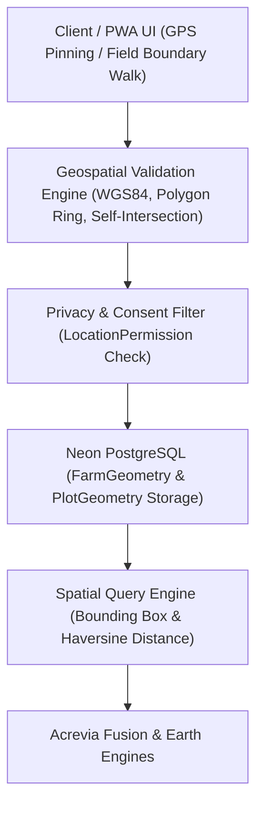

# ACREVIA — GEO-SPATIAL ARCHITECTURE (PILLAR A: ACREVIA GEO)
## Privacy-Preserving Geospatial Foundation for Precision Agriculture

---

## 1. Overview & Architectural Intent
Acrevia Geo provides the geospatial foundation for the ACREVIA platform. Smallholder farmers in Telangana (ranging from 0.5 to 10+ acres) require precise field-level mapping to enable satellite monitoring, localized micro-weather indexing, and soil zoning without compromising their spatial privacy or incurring heavy GIS server dependencies.

---

## 2. Coordinate System & Geometry Specifications

### 2.1 Coordinate Reference System (CRS)
- **Standard:** WGS84 (World Geodetic System 1984), EPSG:4326.
- **Coordinate Order:** `[longitude, latitude]` for GeoJSON compliance (RFC 7946).
- **Precision:** 6 decimal places (approx. 0.11-meter precision at equator, ideal for agricultural parcel delineation).

### 2.2 Geometry Representations
1. **Plot Centroid:** Single point `(latitude, longitude)` representing the operational center of the plot.
2. **Boundary Polygon:** GeoJSON `Polygon` consisting of a linear ring of coordinates `[[[lon1, lat1], [lon2, lat2], ..., [lon1, lat1]]]`.
3. **Bounding Box (BBox):** `[min_lon, min_lat, max_lon, max_lat]` for spatial indexing and rapid pre-filtering.

---

## 3. Geometry Validation Engine

Before persisting any geospatial entity, the `GeospatialService` executes validation gates:
1. **Coordinate Boundary Gate:**
   - Longitude must strictly fall within `[-180.0, 180.0]`.
   - Latitude must strictly fall within `[-90.0, 90.0]`.
   - Regional Telangana bounding check warning if coordinates fall outside `[77.0 to 81.5° E, 15.5 to 19.9° N]`.
2. **Linear Ring Closure:**
   - The boundary ring must contain at least 4 coordinate pairs.
   - The first and last coordinate pair must be strictly identical (`coords[0] == coords[-1]`).
3. **Planar Self-Intersection Test:**
   - Non-adjacent line segments in the ring must not intersect (simple polygon constraint).
4. **Agricultural Acreage Validity:**
   - Area calculated via Geodesic / Spherical Polygon area formula.
   - Plot area must fall within valid agricultural thresholds: `0.02 hectares (approx. 0.05 acres) <= Area <= 500 hectares`.
   - Discrepancy between farmer-declared acreage and computed polygon area is logged as an advisory flag.

---

## 4. Privacy & Location Permission Management

Smallholder spatial boundaries constitute sensitive agricultural data. Acrevia enforces fine-grained permission control:
- **`EXACT_BOUNDARY`:** Full polygonal boundary is accessible for satellite NDVI sampling and micro-climate extraction.
- **`COARSE_VILLAGE`:** Spatial queries are generalized to the village centroid (~2-5 km fuzzing) for general weather and advisory services; exact coordinates are masked from public/shared contexts.
- **`REVOKED`:** All spatial telemetry is paused; remote sensing tasks are disabled for the plot.

---

## 5. Pure SQL / Python Spatial Querying

To maintain 100% cloud portability across Neon PostgreSQL instances without requiring custom native binary PostGIS installations, Acrevia Geo implements:
- **Bounding Box Pre-Filter:** Standard BBox comparison on `(min_lat <= lat <= max_lat) AND (min_lon <= lon <= max_lon)`.
- **Haversine Proximity Filter:** Pure SQL / Python spherical distance calculation:
  $$d = 2R \arcsin\left(\sqrt{\sin^2\left(\frac{\Delta \phi}{2}\right) + \cos(\phi_1)\cos(\phi_2)\sin^2\left(\frac{\Delta \lambda}{2}\right)}\right)$$
  Where $R = 6,371 \text{ km}$.
