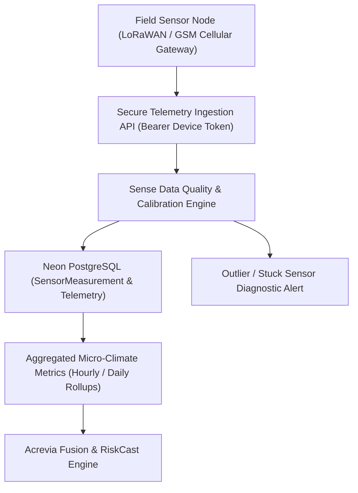

# ACREVIA — IOT & SENSOR ARCHITECTURE (PILLAR C: ACREVIA SENSE)
## In-Situ Ground Telemetry, Device Security & Farm Micro-Environment Ingestion

---

## 1. Overview & Architectural Intent
Acrevia Sense bridges physical farm conditions with digital intelligence. In Telangana's dryland cotton, irrigated paddy, and chilli belts, micro-climate variations (such as canopy humidity, soil moisture depletion, and leaf wetness duration) dictate fungal germination and drought stress hours before symptoms become visible on satellite imagery or ground cameras.



---

## 2. Device Registry & Taxonomy

Each field hardware unit is registered within the multi-tenant farm boundary:

| Device Category | Primary Measurements | Agricultural Purpose | Placement Standard |
|---|---|---|---|
| **Soil Multi-Depth Probe** | Volumetric Water Content (VWC %), Soil Temp (°C), Electrical Conductivity (EC) | Irrigation scheduling, root-zone drought stress, fertilizer salinity | 15 cm & 30 cm depth in active crop root-zone |
| **Micro-Climate Station** | Ambient Temperature (°C), Relative Humidity (RH %), Solar Radiation ($W/m^2$) | Vapor Pressure Deficit (VPD), thermal heat units (GDD) | 1.5m to 2m height above canopy, unshaded |
| **Canopy Leaf Wetness** | Surface electrical impedance (% duration) | Fungal spore germination prediction (Blast, Anthracnose) | Embedded within mid-canopy foliage |
| **NPK Optical/Ion Probe** | Nitrogen, Phosphorus, Potassium (mg/kg estimate) | Nutritional monitoring | Sub-surface furrow placement |

---

## 3. Device Authentication & Ingestion Security

1. **Unique Per-Device Token:** Each hardware device is provisioned with a cryptographic API token (`dev_sec_...`).
2. **Ingestion Endpoint:** `POST /api/v1/sense/telemetry`
3. **Monotonicity & Timestamp Validation:** 
   - Telemetry packets must contain client UTC timestamps.
   - Timestamps older than 7 days or more than 15 minutes into the future are rejected with HTTP 422.
4. **Rate Limiting:** Maximum 60 telemetry packets per minute per device to prevent denial-of-service or compromised firmware loops.

---

## 4. Telemetry Schema & Payload Format

```json
{
  "device_id": "sens-dev-warangal-042",
  "plot_id": "plot-cotton-01",
  "timestamp": "2026-11-08T04:30:00Z",
  "battery_pct": 94.2,
  "signal_rssi": -78,
  "measurements": {
    "soil_moisture_pct": 24.8,
    "soil_temperature_c": 28.5,
    "ambient_temperature_c": 31.2,
    "relative_humidity_pct": 74.0,
    "leaf_wetness_pct": 65.0,
    "solar_radiation_w_m2": 620.0
  }
}
```

---

## 5. Micro-Spatial Representation Safeguards
A probe measures conditions in its immediate radius (~30 cm for soil, ~2m for canopy wetness). Acrevia Sense explicitly flags to farmers that single-node readings provide localized ground truth but do not guarantee uniform field-wide moisture across heterogeneous undulating topography.
