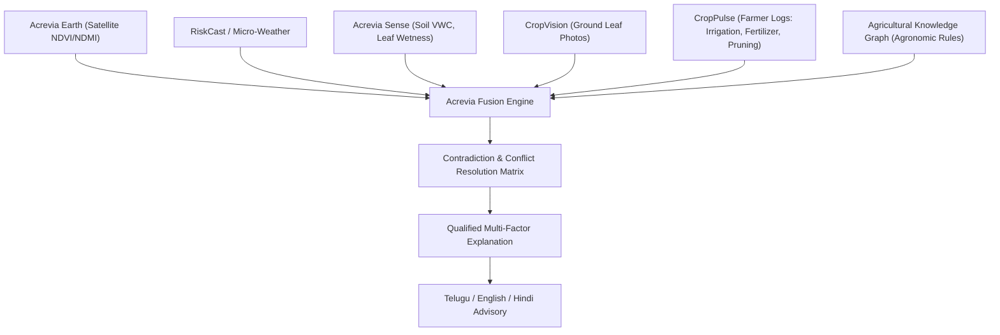

# ACREVIA — MULTI-SOURCE EVIDENCE FUSION (PILLAR D: ACREVIA FUSION)
## Cross-Source Alignment, Conflict Resolution & Evidence-Grounded Agronomic Synthesis

---

## 1. Overview & Architectural Intent
Single-source agricultural recommendations are notoriously prone to errors:
- A satellite sees canopy browning, but cannot tell if it is fungal blight, irrigation failure, or deliberate harvesting.
- A weather station logs high disease favorability, but if the crop is not at a susceptible growth stage or the pathogen is absent, chemical spraying is wasted money.
- A farmer photos a yellow leaf, but whether it is nitrogen deficiency, waterlogging, or root rot requires soil and weather context.

**Acrevia Fusion** aligns all evidence streams into a unified, traceable agronomic assessment:



---

## 2. Evidence Streams & Epistemic Tiers

| Evidence Stream | Modality | Epistemic Nature | Spatial / Temporal Scale |
|---|---|---|---|
| **CropVision** | Smartphone RGB Imagery | **Direct visual confirmation** of localized pathogen symptoms or pest presence | Millimeter to leaf level; episodic snapshot |
| **Acrevia Sense** | In-situ physical sensors | **Direct localized physical measurement** of micro-environment | Centimeter to plot probe; continuous 15-min |
| **RiskCast / Weather** | Grid API & Forecast | **Environmental predisposition / risk factor** (Favorable temperature/RH) | 1-5 km grid; hourly / 7-day forecast |
| **Acrevia Earth** | Sentinel-2 / Landsat | **Remote proxy of canopy vigor & moisture dynamics** | 10m-30m pixel; 3-5 day revisit |
| **CropPulse Operations** | Farmer self-logs | **Ground operational truth** (fertilizer applied, pruning done, harvest started) | Plot level; event-driven |
| **Knowledge Graph** | Structured agronomic ontology | **Domain causal principles & cultivar susceptibility** | Universal biological rules |

---

## 3. Contradiction Matrix & Conflict Resolution

When streams point in differing directions, Acrevia Fusion enforces deterministic resolution rules rather than averaging away vital anomalies:

### Scenario 1: Sharp NDVI Decline with Recent Operation Logged
- **Observation:** Satellite NDVI drops by $-0.22$ over 5 days.
- **Farmer Operations Log:** Farmer recorded `TOPPING_AND_PRUNING` or `PARTIAL_HARVEST` 3 days prior.
- **Resolution:** Suppress disease alarm. Reclassify canopy decline as **operational vegetative removal**, not pest/disease catastrophe.

### Scenario 2: High NDVI with Sustained High Fungal Disease Pressure
- **Observation:** Satellite NDVI is robust ($0.76$, green canopy).
- **Sense & Weather:** Leaf wetness $> 11$ continuous hours, ambient temperature $24^\circ\text{C}$, relative humidity $88\%$.
- **Knowledge Graph:** High susceptibility window for Rice Blast (*Magnaporthe oryzae*).
- **Resolution:** Issue **Pre-Symptomatic Preventive Alert**. Explain to farmer that canopy currently looks lush, but micro-environmental conditions are primed for fungal spore germination within the next 48-72 hours.

### Scenario 3: Divergence Between Soil Probe and Weather Rainfall
- **Observation:** Weather model reports 35mm rain event, but root-zone probe shows soil moisture drop to $14\%$.
- **Resolution:** Flag `LOCAL_MICROCLIMATE_DISCREPANCY`. Investigate whether localized rain skipped the micro-catchment or soil sensor has poor soil-probe contact/air pocket.

---

## 4. Multi-Factor Synthesis Schema

The output of Acrevia Fusion is structured into traceable evidence components:
```json
{
  "plot_id": "plot-cotton-01",
  "overall_vigor_status": "MODERATE_STRESS",
  "primary_stress_driver": "MOISTURE_DEFICIT",
  "evidence_components": {
    "satellite": {
      "ndvi_trend": "DECLINING",
      "qualifier": "Canopy greenness down 8% over 14 days"
    },
    "soil_sensor": {
      "moisture_vwc": 16.2,
      "qualifier": "Root zone below wilting point threshold"
    },
    "crop_vision": {
      "recent_diagnosis": "HEALTHY_WITH_HEAT_STRESS",
      "qualifier": "No fungal lesions detected on leaf sample"
    }
  },
  "conflicts_detected": [],
  "farmer_synthesis": {
    "en": "Canopy decline is primarily driven by root-zone moisture deficit rather than disease. Irrigation recommended.",
    "te": "పంట ఆకుల తగ్గుదల ప్రధానంగా నేలలో తేమ కొరత వల్ల వచ్చింది, తెగులు వల్ల కాదు. తడి అందించడం అవసరం.",
    "hi": "फसल की गिरावट मुख्य रूप से जड़ क्षेत्र में नमी की कमी के कारण है, न कि किसी बीमारी के कारण। सिंचाई की सलाह दी जाती है।"
  }
}
```
