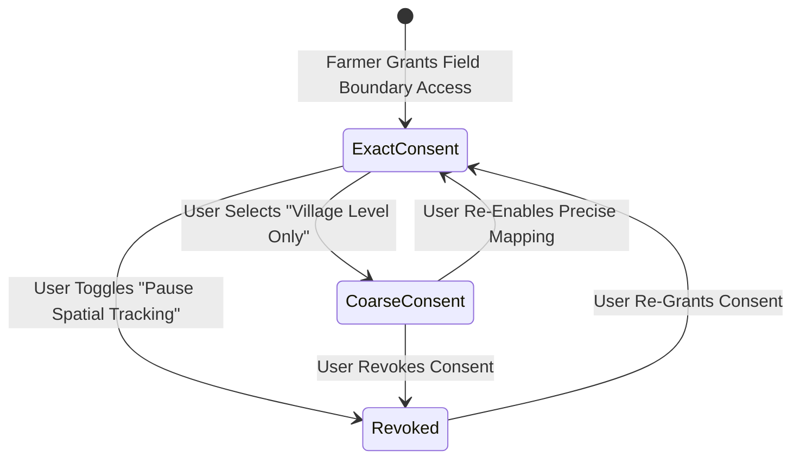

# ACREVIA — PRIVACY AND DATA GOVERNANCE SPECIFICATION
## Geospatial Rights, IoT Telemetry Stewardship & Agricultural Data Sovereignty

---

## 1. Principles of Agricultural Data Sovereignty
In smallholder agriculture, farm boundary geometries, crop yields, and financial records represent critical sovereign assets. Unregulated aggregation often leads to predatory input pricing, speculative land acquisitions, or arbitrary credit denial.

ACREVIA guarantees:
1. **Farmer Ownership:** The farmer retains exclusive proprietary ownership over their farm boundaries, sensor telemetry, and harvest yield records.
2. **Purpose Limitation:** Spatial and sensor data are collected strictly for direct agronomic advisory and precision farming workflows requested by the farmer.
3. **Revocability:** Farmers can revoke location permissions or delete plot geometries at any time with immediate cascading purges of spatial indices.

---

## 2. Granular Privacy Tiers (`LocationPermission`)

- **Tier 1: `EXACT_BOUNDARY`**
  - Uses full polygon for sub-field Sentinel-2 10m zonal extraction and localized micro-weather indexing.
  - Geometry is isolated behind tenant-level authorization checks.
- **Tier 2: `COARSE_VILLAGE`**
  - Plot centroid is snapped to the nearest village centroid (~2-5 km random offset).
  - Used for regional monsoon risk and generalized agro-meteorological advisories.
  - Prevents third-party reconstruction of specific land parcel boundaries.
- **Tier 3: `REVOKED`**
  - All satellite queries and geospatial API calls return 403 Forbidden or empty responses.

---

## 3. Data Retention & Anonymization Standards
- **Telemetry Aggregation:** High-frequency raw sensor telemetry (15-min packets) is archived after 90 days into daily summaries (mean, min, max, duration above threshold).
- **Research Anonymization:** Any agronomic research models (such as yield baseline training) utilize strictly de-identified datasets stripped of `user_id`, `farm_id`, `survey_number`, and exact coordinates, retaining only regional agro-climatic zone and soil taxonomy.
