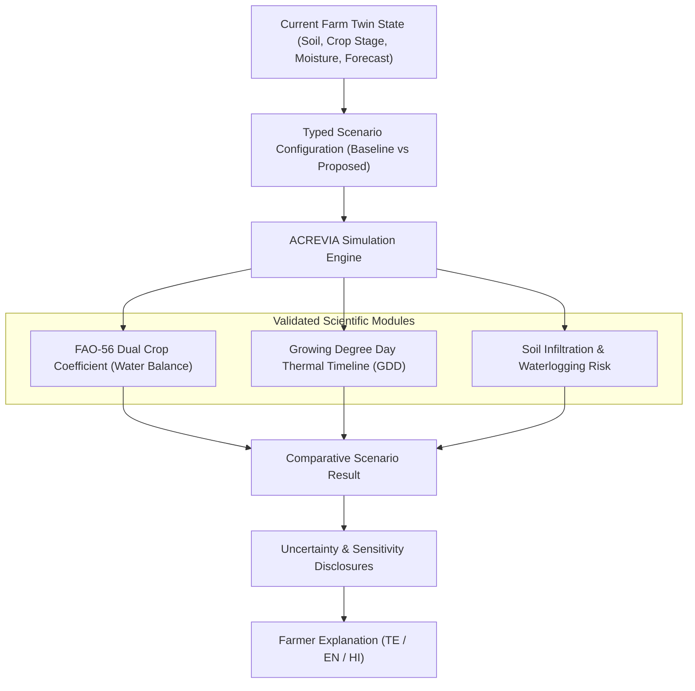

# ACREVIA — AGRICULTURAL SIMULATION ENGINE (PILLAR B: ACREVIA SIMULATE)
## Explainable Scenario Modeling, Agronomic Formulations & Uncertainty Bounds

---

## 1. Overview & Epistemic Boundaries
ACREVIA Simulate enables farmers and agronomists to evaluate "what-if" agricultural scenarios before deploying labor, water, or inputs.

> [!IMPORTANT]
> **SIMULATION INTEGRITY MANDATE:**
> A simulation is a **conditional computational exploration under explicit assumptions**, not an infallible prediction of the future.
> The simulation engine strictly reports:
> *"Under the stated assumptions (soil texture, 5-day weather forecast, and irrigation volume), this scenario suggests..."*
> Under no circumstances may the simulation engine output unconditional guarantees such as *"This will increase your cotton yield by 20%"*.

---

## 2. Core Agronomic Simulation Models

### 2.1 Irrigation Water Balance Model (FAO-56 Formulation)
Calculates root-zone soil water depletion ($D_{r,i}$) on daily increments:
$$D_{r,i} = D_{r,i-1} - (P_i - RO_i) - I_i - CR_i + ET_{c,i} + DP_i$$
Where:
- $D_{r,i}$: Root zone depletion at the end of day $i$ [mm].
- $P_i$: Precipitation [mm].
- $RO_i$: Runoff from soil surface [mm].
- $I_i$: Net irrigation depth [mm].
- $CR_i$: Capillary rise from groundwater [mm].
- $ET_{c,i}$: Crop evapotranspiration $= K_c \times ET_0$ [mm/day].
  - Reference evapotranspiration $ET_0$ computed via Hargreaves-Samani / Penman-Monteith from weather observations.
  - Crop coefficients ($K_c$) for Telangana:
    - Cotton: Initial $0.35$, Mid-Season $1.20$, End-Season $0.50$.
    - Rice: Initial $1.05$, Mid-Season $1.20$, Ripening $0.90$.
    - Chilli: Initial $0.60$, Flowering/Fruiting $1.05$, Harvest $0.80$.
- Readily Available Water ($RAW$):
  $$RAW = p \times TAW = p \times 1000 \times (\theta_{FC} - \theta_{WP}) \times Z_r$$
  - $\theta_{FC}$: Field capacity (Black Cotton soil $\approx 0.38$, Red Chalka $\approx 0.22$).
  - $\theta_{WP}$: Wilting point (Black Cotton $\approx 0.20$, Red Chalka $\approx 0.10$).
  - $Z_r$: Effective rooting depth ($0.6\text{m}$ to $1.2\text{m}$ for mature cotton).
  - $p$: Soil water depletion fraction without stress ($0.65$ for cotton, $0.20$ for paddy, $0.30$ for chilli).

### 2.2 Rainfall & Waterlogging Stress Model
- Compares forecast 24h precipitation against soil saturated hydraulic conductivity ($K_{sat}$).
- If cumulative rainfall over 48 hours exceeds soil storage capacity above field capacity, the engine flags **Waterlogging & Root Hypoxia Risk**:
  $$\text{Waterlogging Risk Index} = \frac{\sum_{t=1}^{48} P_t - (I_s \times 48)}{\text{Drainable Porosity} \times Z_r}$$
- Recommends surface trenching and furrow drainage before heavy downpours.

### 2.3 Growing Degree Days (GDD) Thermal Progression
$$GDD = \sum \max\left(\frac{T_{\max} + T_{\min}}{2} - T_{\text{base}}, 0\right)$$
- Base temperatures:
  - Cotton: $T_{\text{base}} = 15.6^\circ\text{C}$
  - Rice: $T_{\text{base}} = 10.0^\circ\text{C}$
  - Chilli: $T_{\text{base}} = 12.0^\circ\text{C}$
- Projects projected dates for square formation, flowering, and boll opening based on forecast temperatures.

---

## 3. Scenario Comparison Engine

ACREVIA Simulate evaluates at least two alternative scenarios side-by-side:
- **Baseline Scenario:** Current recorded field plan (e.g., standard interval irrigation every 7 days).
- **Alternative Scenario A:** Weather-adjusted dynamic irrigation (e.g., delay watering by 4 days due to forecast 35mm rain).
- **Alternative Scenario B:** Deficit regulated irrigation (e.g., maintain $70\% RAW$ to conserve borewell water).

Outputs structured comparison metrics:
- Estimated water applied (liters / acre).
- Root-zone moisture deficit profile.
- Days under moisture or waterlogging stress.
- Sensitivity to $\pm 20\%$ rainfall variance.
- Actionable farmer advice in Telugu, English, and Hindi.
