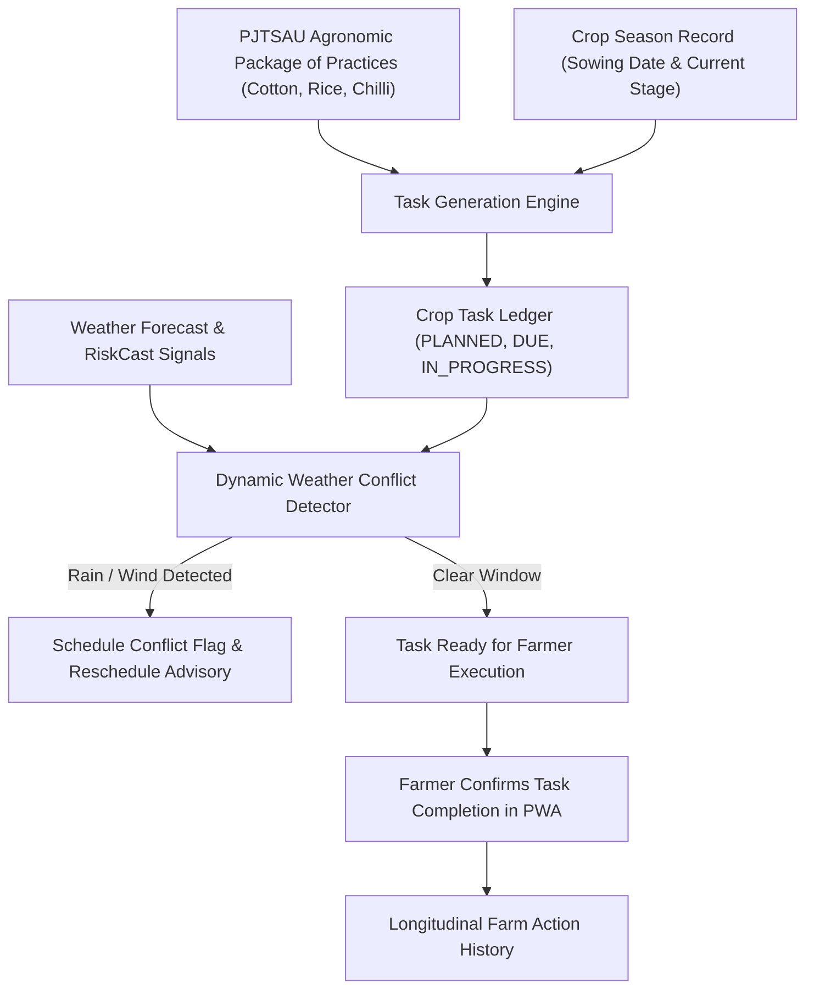

# ACREVIA — CROP LIFECYCLE AND OPERATIONS PLANNING (PILLAR D: ACREVIA PLAN)
## Agronomic Crop Calendars, Task Lifecycle & Weather-Responsive Dynamic Scheduling

---

## 1. Overview & Operational Intent
ACREVIA Plan translates high-level agronomic guidance from Professor Jayashankar Telangana State Agricultural University (PJTSAU) and ICAR into day-to-day, executable field operations customized to each plot's sowing date, cultivar, and micro-climate.

---

## 2. Telangana Priority Crop Calendars

### 2.1 Cotton (*Gossypium hirsutum*) — Kharif Rainfed/Irrigated
- **Stage 1: Sowing & Emergence (Days 0–15):** Deep summer ploughing, basal fertilizer (DAP + MOP), acid-delinted seed treatment with Imidacloprid, sowing with 90x60 cm or 120x45 cm spacing.
- **Stage 2: Vegetative Growth (Days 16–45):** Gap filling, inter-cultivation/weeding at 20 & 40 DAS, first top-dressing of Urea.
- **Stage 3: Square Formation & Early Flowering (Days 46–75):** Install pheromone traps for Pink Bollworm (8 traps/acre), monitor sucking pests (aphids, jassids, whitefly), second fertilizer top-dressing.
- **Stage 4: Boll Formation & Development (Days 76–120):** Foliar spray of 19-19-19 or 13-0-45 (Multi-K) to support boll filling, monitor boll rot and bacterial blight.
- **Stage 5: Boll Bursting & Picking (Days 121–160+):** First manual picking when bolls fully open on dry mornings, store picked kapas in moisture-free shed.

### 2.2 Rice (*Oryza sativa*) — Kharif/Rabi
- **Nursery & Land Preparation (Days 0–25):** Raised bed nursery, sprouted seed broadcasting, puddle main field with tractor cage wheels.
- **Transplanting (Days 25–35):** 2–3 seedlings per hill at 2–3 cm depth with 15x15 cm spacing.
- **Tillering (Days 36–60):** Alternate wetting and drying (AWD) water management, maintain shallow 2–5 cm water layer, top-dress Urea.
- **Panicle Initiation & Flowering (Days 61–90):** Inspect for Rice Blast and Stem Borer, maintain 5 cm water standing depth.
- **Ripening & Harvest (Days 91–125):** Drain water 10–12 days prior to harvest, harvest when 80–85% grains turn golden yellow.

### 2.3 Chilli (*Capsicum annuum*)
- **Nursery & Main Field Prep (Days 0–40):** Pro-tray seedlings under shade net, deep ploughing with FYM application.
- **Transplanting (Days 40–50):** Ridge and furrow planting, dip seedlings in Trichoderma viride suspension.
- **Vegetative & Branching (Days 51–80):** Weeding, earthing up, monitor yellow mite and thrips (upward leaf curling).
- **Flowering & Fruit Set (Days 81–130):** Foliar micronutrient spray, monitor Anthracnose/Dieback.
- **Harvesting & Drying (Days 131–180):** Pick fully ripe red fruits, sun-dry on clean tarpaulins to $<10\%$ moisture.

---

## 3. Task Lifecycle & State Transitions

Tasks progress through formal states:
- `PLANNED`: Scheduled based on crop calendar and sowing date.
- `DUE`: Due date is within the current 48-hour window.
- `IN_PROGRESS`: Farmer has acknowledged starting the task.
- `COMPLETED`: Farmer has logged completion, inputs used, and notes.
- `SKIPPED`: Farmer explicitly bypassed the task with an optional reason.
- `RESCHEDULED`: Task moved to a future date due to rain or labor constraint.
- `CANCELLED`: Obsoleted by changed crop status.

---

## 4. Dynamic Weather Conflict Detection Rules

Before prompting the farmer to perform a scheduled task:
1. **Foliar Spraying Conflict:** If precipitation $\ge 5\text{ mm}$ is forecast within 6 hours of due date, or wind speed $> 18\text{ km/h}$, flag `WEATHER_CONFLICT` with message:
   > *"High wind speed or incoming rain detected. Chemical foliar spray postponed to prevent spray drift and wash-off."*
2. **Irrigation Conflict:** If rainfall $\ge 15\text{ mm}$ is forecast within 48 hours, flag `WEATHER_CONFLICT` with message:
   > *"Rainfall expected. Postpone planned flood/borewell irrigation to avoid waterlogging and electricity waste."*
3. **Harvesting Conflict:** If rain is forecast during boll picking or chilli drying, flag `WEATHER_CONFLICT` to accelerate harvest or cover produce with tarpaulins.
