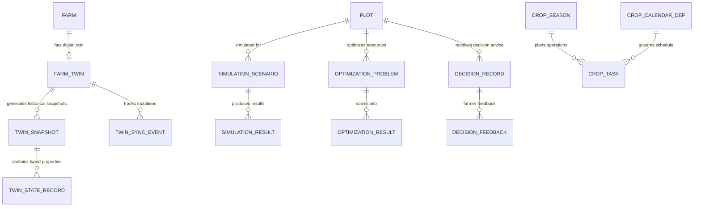

# ACREVIA — DATABASE AND DATA MODEL SPECIFICATION (STAGE 10)
## Neon PostgreSQL Schema Extensions for Digital Twin, Simulation, Optimization, Planning & Decision Intelligence

---

## 1. Overview & Data Architecture
All Stage 10 entities reside within the single canonical **Neon PostgreSQL 16** database in Singapore (`sin1`), extending the 42 existing tables without data duplication.

---

## 2. Table Schemas & Relational Contracts

### 2.1 Digital Twin Subsystem
- **`farm_twins`**:
  - `id`: VARCHAR(36) PK
  - `farm_id`: VARCHAR(36) UNIQUE FK -> farms.id ON DELETE CASCADE
  - `twin_version`: VARCHAR(20) DEFAULT '1.0.0'
  - `state_status`: VARCHAR(30) DEFAULT 'ACTIVE' -- ACTIVE, STALE, RECONCILING, ERROR
  - `last_synchronized_at`: TIMESTAMP WITH TIME ZONE NOT NULL
  - `completeness_score`: FLOAT DEFAULT 0.0
  - `created_at`, `updated_at`: TIMESTAMP WITH TIME ZONE

- **`twin_snapshots`**:
  - `id`: VARCHAR(36) PK
  - `twin_id`: VARCHAR(36) FK -> farm_twins.id ON DELETE CASCADE
  - `farm_id`: VARCHAR(36) FK -> farms.id ON DELETE CASCADE
  - `plot_id`: VARCHAR(36) FK -> plots.id ON DELETE CASCADE (Nullable)
  - `crop_season_id`: VARCHAR(36) FK -> crop_seasons.id ON DELETE SET NULL
  - `snapshot_version`: VARCHAR(20) NOT NULL
  - `state_payload_json`: JSONB NOT NULL -- Full immutable state capture
  - `source_manifest_json`: JSONB NOT NULL -- Stream provenance & timestamps
  - `data_completeness_pct`: FLOAT NOT NULL
  - `generated_at`: TIMESTAMP WITH TIME ZONE NOT NULL
  - `created_by`: VARCHAR(36) FK -> users.id

- **`twin_state_records`**:
  - `id`: VARCHAR(36) PK
  - `snapshot_id`: VARCHAR(36) FK -> twin_snapshots.id ON DELETE CASCADE
  - `entity_type`: VARCHAR(50) NOT NULL -- FARM, PLOT, CROP_SEASON, SOIL, WEATHER, SENSOR, VISION
  - `entity_id`: VARCHAR(36) NOT NULL
  - `property_name`: VARCHAR(100) NOT NULL -- e.g., root_zone_moisture, ndvi_trend, current_stage
  - `property_value_json`: JSONB NOT NULL
  - `unit`: VARCHAR(30)
  - `provenance_type`: VARCHAR(50) NOT NULL -- MEASURED, FARMER_REPORTED, EXPERT_REVIEWED, AI_ESTIMATED, PROVIDER_OBSERVATION, SIMULATED, INFERRED, UNKNOWN
  - `source_reference`: VARCHAR(200) NOT NULL
  - `observed_at`: TIMESTAMP WITH TIME ZONE NOT NULL
  - `quality_status`: VARCHAR(30) DEFAULT 'VALID'

- **`twin_sync_events`**:
  - `id`: VARCHAR(36) PK
  - `twin_id`: VARCHAR(36) FK -> farm_twins.id ON DELETE CASCADE
  - `event_type`: VARCHAR(50) NOT NULL
  - `event_hash`: VARCHAR(64) UNIQUE NOT NULL
  - `payload_json`: JSONB NOT NULL
  - `processed_at`: TIMESTAMP WITH TIME ZONE DEFAULT CURRENT_TIMESTAMP

### 2.2 Agricultural Simulation Subsystem
- **`simulation_scenarios`**:
  - `id`: VARCHAR(36) PK
  - `plot_id`: VARCHAR(36) FK -> plots.id ON DELETE CASCADE
  - `crop_season_id`: VARCHAR(36) FK -> crop_seasons.id ON DELETE CASCADE
  - `creator_id`: VARCHAR(36) FK -> users.id ON DELETE RESTRICT
  - `scenario_type`: VARCHAR(50) NOT NULL -- IRRIGATION_WATER_BALANCE, RAINFALL_WATERLOGGING_STRESS, THERMAL_GDD_STAGE, INPUT_APPLICATION
  - `scenario_name`: VARCHAR(150) NOT NULL
  - `baseline_snapshot_id`: VARCHAR(36) FK -> twin_snapshots.id ON DELETE SET NULL
  - `input_parameters_json`: JSONB NOT NULL
  - `farmer_assumptions_json`: JSONB DEFAULT '{}'::jsonb
  - `constraints_json`: JSONB DEFAULT '{}'::jsonb
  - `status`: VARCHAR(30) DEFAULT 'CREATED' -- CREATED, RUNNING, COMPLETED, FAILED, CANCELLED

- **`simulation_results`**:
  - `id`: VARCHAR(36) PK
  - `scenario_id`: VARCHAR(36) UNIQUE FK -> simulation_scenarios.id ON DELETE CASCADE
  - `model_name`: VARCHAR(100) NOT NULL -- FAO-56 Dual Crop Coefficient, GDD-Telangana-v1
  - `model_version`: VARCHAR(50) NOT NULL
  - `outputs_json`: JSONB NOT NULL
  - `uncertainty_metadata_json`: JSONB NOT NULL
  - `evidence_sources_json`: JSONB NOT NULL
  - `execution_duration_ms`: INTEGER NOT NULL
  - `completed_at`: TIMESTAMP WITH TIME ZONE NOT NULL

### 2.3 Resource Optimization Subsystem
- **`optimization_problems`**:
  - `id`: VARCHAR(36) PK
  - `farm_id`: VARCHAR(36) FK -> farms.id ON DELETE CASCADE
  - `plot_id`: VARCHAR(36) FK -> plots.id ON DELETE SET NULL
  - `problem_type`: VARCHAR(50) NOT NULL -- WATER_ALLOCATION, INPUT_BUDGET, LABOR_SCHEDULING
  - `objective_type`: VARCHAR(50) NOT NULL -- MINIMIZE_WATER_USE, MAXIMIZE_COVERAGE, MINIMIZE_SCHEDULE_CONFLICTS
  - `decision_variables_json`: JSONB NOT NULL
  - `hard_constraints_json`: JSONB NOT NULL
  - `soft_constraints_json`: JSONB DEFAULT '{}'::jsonb
  - `status`: VARCHAR(30) DEFAULT 'PENDING'

- **`optimization_results`**:
  - `id`: VARCHAR(36) PK
  - `problem_id`: VARCHAR(36) UNIQUE FK -> optimization_problems.id ON DELETE CASCADE
  - `feasibility_status`: VARCHAR(30) NOT NULL -- OPTIMAL, FEASIBLE, NO_FEASIBLE_SOLUTION, UNBOUNDED
  - `selected_solution_json`: JSONB
  - `alternative_solutions_json`: JSONB DEFAULT '[]'::jsonb
  - `conflicting_constraints_json`: JSONB DEFAULT '[]'::jsonb
  - `trade_off_analysis_json`: JSONB
  - `solver_name`: VARCHAR(50) NOT NULL
  - `solved_at`: TIMESTAMP WITH TIME ZONE NOT NULL

### 2.4 Crop Planning & Task Subsystem
- **`crop_calendar_definitions`**:
  - `id`: VARCHAR(36) PK
  - `crop_id`: VARCHAR(50) NOT NULL -- cotton, rice, chilli
  - `variety_id`: VARCHAR(36)
  - `agro_climatic_zone`: VARCHAR(100) DEFAULT 'Telangana-Central'
  - `growth_stage`: VARCHAR(50) NOT NULL -- SOWING, VEGETATIVE, FLOWERING, FRUITING_BOLL, MATURITY
  - `typical_duration_days`: INTEGER NOT NULL
  - `recommended_tasks_json`: JSONB NOT NULL -- Prescribed field tasks from PJTSAU
  - `source_citation`: VARCHAR(255) NOT NULL
  - `version`: VARCHAR(20) DEFAULT '1.0'

- **`crop_tasks`**:
  - `id`: VARCHAR(36) PK
  - `crop_season_id`: VARCHAR(36) FK -> crop_seasons.id ON DELETE CASCADE
  - `plot_id`: VARCHAR(36) FK -> plots.id ON DELETE CASCADE
  - `calendar_def_id`: VARCHAR(36) FK -> crop_calendar_definitions.id ON DELETE SET NULL
  - `task_name`: VARCHAR(150) NOT NULL
  - `task_category`: VARCHAR(50) NOT NULL -- LAND_PREPARATION, SOWING, IRRIGATION, NUTRIENT, SCOUTING, WEEDING, HARVEST
  - `due_date`: DATE NOT NULL
  - `completed_date`: DATE
  - `status`: VARCHAR(30) DEFAULT 'PLANNED' -- PLANNED, DUE, IN_PROGRESS, COMPLETED, SKIPPED, RESCHEDULED, CANCELLED
  - `weather_conflict_flag`: BOOLEAN DEFAULT FALSE
  - `conflict_reason`: VARCHAR(255)
  - `notes`: TEXT

### 2.5 Decision Intelligence Subsystem
- **`decision_records`**:
  - `id`: VARCHAR(36) PK
  - `plot_id`: VARCHAR(36) FK -> plots.id ON DELETE CASCADE
  - `farmer_id`: VARCHAR(36) FK -> users.id ON DELETE RESTRICT
  - `query_text`: TEXT NOT NULL
  - `decision_category`: VARCHAR(50) NOT NULL -- CROP_MONITORING, WATER_PLANNING, INPUT_PLANNING, DISEASE_ACTION, HARVEST
  - `recommendation_state`: VARCHAR(50) NOT NULL -- INFORMATIONAL, EVIDENCE_SUPPORTED, SCENARIO_RESULT, REQUIRES_MORE_INFORMATION, REQUIRES_EXPERT_REVIEW, INSUFFICIENT_EVIDENCE, NOT_SUPPORTED
  - `evidence_sources_json`: JSONB NOT NULL
  - `grounded_explanation_en`: TEXT NOT NULL
  - `grounded_explanation_te`: TEXT NOT NULL
  - `grounded_explanation_hi`: TEXT NOT NULL
  - `uncertainty_disclosures_json`: JSONB NOT NULL
  - `expert_escalation_case_id`: VARCHAR(36) FK -> expert_review_cases.id ON DELETE SET NULL
  - `created_at`: TIMESTAMP WITH TIME ZONE DEFAULT CURRENT_TIMESTAMP

- **`decision_feedbacks`**:
  - `id`: VARCHAR(36) PK
  - `decision_id`: VARCHAR(36) FK -> decision_records.id ON DELETE CASCADE
  - `farmer_action_taken`: VARCHAR(50) -- FOLLOWED_ADVICE, MODIFIED_ACTION, IGNORED, EXPERT_REQUESTED
  - `farmer_rating`: INTEGER -- 1 to 5
  - `feedback_notes`: TEXT
  - `observed_outcome`: VARCHAR(50) -- IMPROVED, UNCHANGED, WORSENED, UNKNOWN
  - `recorded_at`: TIMESTAMP WITH TIME ZONE DEFAULT CURRENT_TIMESTAMP
