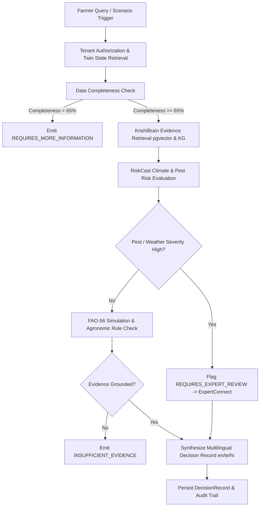

# ACREVIA STAGE 10: DECISION INTELLIGENCE ARCHITECTURE
## Pillar E — Unified Agricultural Decision Support & Evidence Grounding

---

## 1. Executive Summary & Objective

In agricultural operations across Telangana, farmers and extension officers face complex, multi-variable decisions where weather volatility, soil moisture, pest pressure, and resource constraints intersect. Flawed or ungrounded recommendations risk catastrophic crop failure or severe economic distress.

The **ACREVIA Decision Intelligence Engine** acts as the synthesis and recommendation apex of the platform. Rather than functioning as a black-box LLM or an unverified heuristic rule engine, it deterministically binds:
1. **Digital Twin State & Completeness:** Authorized, current parameters of the farm and plot with strict 8-tier provenance tracking.
2. **Knowledge Evidence Grounding:** Verified agricultural science chunks and entity relations from KrishiBrain (PJTSAU protocols, ICAR bulletins).
3. **Environmental & Agronomic Risk:** RiskCast climate risk scores, pest alerts, and weather forecasts.
4. **Counterfactual Simulation:** Scenario evaluation via FAO-56 dual crop coefficient water balance and GDD thermal progression.

---

## 2. Recommendation State Machine

Every decision query evaluated by ACREVIA is assigned one of seven canonical recommendation states. This guarantees strict safety boundaries and prevents unwarranted confidence:

| Recommendation State | Definition & Agronomic Criteria | System Action |
|:---|:---|:---|
| `INFORMATIONAL` | General agronomic best practice or background context with no immediate operational intervention required. | Provides educational guidance with cited PJTSAU references. |
| `EVIDENCE_SUPPORTED` | Full alignment between current twin state, low-to-moderate risk signals, and verified PJTSAU package of practices. | Delivers actionable recommendation with cited sources and operational parameters. |
| `SCENARIO_RESULT` | Counterfactual exploration requested by farmer (e.g., "What if I irrigate 4 days early?"). | Presents simulated outcomes, water depletion trajectories, and risk trade-offs with explicit conditional disclaimers. |
| `REQUIRES_MORE_INFORMATION` | Twin completeness vector < 65% or missing critical variables (e.g., sowing date, soil texture, crop variety). | Prompts the farmer for missing data points before issuing operational guidance. |
| `REQUIRES_EXPERT_REVIEW` | High pest infestation, severe weather warning, unverified symptomology, or chemical intervention required. | Automatically packages decision context and creates an escalation case in ExpertConnect for human agronomist review. |
| `INSUFFICIENT_EVIDENCE` | No verified scientific literature or research bulletins found in KrishiBrain vector store or knowledge graph. | Refuses to generate an ad-hoc LLM response; admits lack of verified evidence and recommends consulting local KVK. |
| `NOT_SUPPORTED` | Query violates safety policies, requests banned chemicals (e.g., monocrotophos on vegetables), or falls outside supported crops. | Rejects request with clear regulatory and safety rationale. |

---

## 3. Decision Synthesis Pipeline

The decision engine runs as a deterministic, multi-stage pipeline:

---

## 4. Grounded Explanation Engine & Localization

Recommendations must be clearly understood by smallholder farmers in their native languages without technical jargon or hallucinated claims:

- **Telugu (`te`):** Grammatically accurate, localized agricultural vocabulary (e.g., 'నీటి ఎద్దడి' for water stress, 'పైరు దశ' for growth stage, 'మొక్కజొన్న' / 'పత్తి' / 'వరి' / 'మిర్చి').
- **Hindi (`hi`):** Standard agricultural Hindi aligned with ICAR and Krishi Vigyan Kendra advisories (e.g., 'सिंचाई का समय', 'कीट प्रकोप').
- **English (`en`):** Precise technical agronomic terminology for researchers, extension workers, and agronomists.

### Grounding Invariants:
1. **Zero Yield Guarantees:** The engine never uses terms like "guaranteed yield increase", "100% pest eradication", or "assured revenue". All projections are expressed as conditional ranges with documented uncertainty intervals.
2. **Full Provenance Transparency:** Every recommendation links back to the specific KrishiBrain chunk ID, PJTSAU package of practice chapter, or simulation run identifier.

---

## 5. Human-in-the-Loop Feedback & Outcome Tracking

To continuously evaluate decision quality and model drift:
- Farmers record feedback on recommendations (`ADOPTED`, `PARTIALLY_ADOPTED`, `REJECTED`, `INAPPLICABLE`).
- Realized outcomes (observed yield, pest reduction, water savings) are logged back to the farm digital twin at harvest or post-intervention.
- Any recommendation that led to adverse outcomes is flagged for immediate review by the engineering and agricultural research team.
