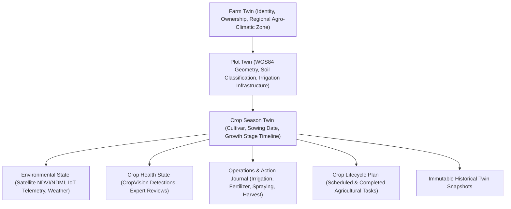

# ACREVIA — DIGITAL TWIN ARCHITECTURE (PILLAR A: ACREVIA TWIN)
## Structured Multi-Layered Farm Representation, Provenance Tracking & State Integrity

---

## 1. Overview & Architectural Philosophy
The **ACREVIA Digital Twin** is an operational, continuously updated digital representation of each farm holding, its sub-plots, and its crop seasons. 

Rather than a cosmetic 3D mesh, the ACREVIA Twin is a **state engine** that models the physical, biological, operational, and environmental dynamics of the farm.

---

## 2. Digital Twin Entity Hierarchy

The twin maintains 1:1 identity alignment with existing ACREVIA domain entities:
1. **Farm Twin:** Root container managing farmer ownership, gross acreage, geographic district/mandal/village, and location privacy tiers (`EXACT_BOUNDARY`, `COARSE_VILLAGE`, `REVOKED`).
2. **Plot Twin:** Specific parcel holding bounded by WGS84 GeoJSON polygon, soil texture classification (`BLACK_COTTON`, `RED_CHALKA`, `ALLUVIAL`), irrigation method (`BOREWELL`, `CANAL`, `DRIP`, `RAINFED`), and sensor node assignments.
3. **Crop Season Twin:** Active or completed crop cycle for Cotton, Rice, or Chilli, tracking sowing date, crop variety, cumulative Growing Degree Days (GDD), and stage progression (`SOWING`, `VEGETATIVE`, `FLOWERING`, `MATURITY`, `HARVESTED`).
4. **State Components:**
   - **Environmental State:** Time-series satellite indices, soil moisture/temperature, ambient weather, and RiskCast disease favorability.
   - **Crop Health State:** Foliar diagnosis inferences, uncertainty margins, expert reviews, and image quality flags.
   - **Operational State:** Recorded interventions, fertilizer applications, and field operations.
   - **Outcome State:** Observed crop recovery, follow-up photos, and verified harvest measurements.

---

## 3. Strict Source-of-Truth Hierarchy (Provenance)

Every state attribute stored within the digital twin is decorated with a strict provenance enumeration:

| Provenance Type | Meaning & Definition | Concrete System Examples |
|---|---|---|
| **`MEASURED`** | Direct physical measurement from calibrated field hardware or scales. | Calibrated IoT soil moisture probe (VWC %), certified weighbridge harvest slip. |
| **`FARMER_REPORTED`** | Information manually entered by the cultivator without third-party instrumentation. | Sowing date, fertilizer dosage entered in journal, soil type self-reported. |
| **`EXPERT_REVIEWED`** | Clinical finding verified by a credentialed agricultural university or KVK agronomist. | Expert assessment confirming Rice Blast, customized IPM prescription. |
| **`AI_ESTIMATED`** | Inferred output generated by computer vision or machine learning models. | CropVision MobileNetV3 lesion classification, satellite optical NDVI greenness proxy. |
| **`PROVIDER_OBSERVATION`** | Broad-scale observations from external remote sensing or meteorological platforms. | Sentinel-2 L2A tile reflectance, Open-Meteo grid weather forecast. |
| **`SIMULATED`** | Conditional output generated by the ACREVIA Simulate scenario engine under explicit assumptions. | FAO-56 dual crop coefficient irrigation water balance, waterlogging risk index. |
| **`INFERRED`** | Algorithmic deduction from deterministic agronomic rules or knowledge graph traversals. | PJTSAU package of practices linkage, spray timing restriction based on wind speed. |
| **`UNKNOWN`** | Missing or unrecorded data. | Sub-surface electrical conductivity when no soil probe is deployed. **Never fabricated.** |

---

## 4. Immutable Historical Twin Snapshots

To support longitudinal comparative analysis across seasons and transparent post-season post-mortems:
- When a significant agricultural event occurs (e.g., stage transition, major intervention, monthly audit, or harvest), a `TwinSnapshot` is generated.
- The snapshot stores a frozen, read-only JSON payload containing:
  - Full plot and crop state at timestamp $t$.
  - Source timestamps for all constituent data streams.
  - Active model versions (CropVision model, RiskCast rule version, simulation engine version).
  - Data completeness index at the time of snapshot.
- **Immutability Invariant:** Once written, historical snapshots are read-only and never modified by subsequent telemetry or backfills.

---

## 5. Data Completeness Architecture

Rather than condensing complex multi-attribute states into an unscientific "farm health score", ACREVIA Twin provides an **epistemic data completeness vector**:

$$\text{Completeness} = \frac{\sum_{i=1}^{M} w_i \cdot \mathbb{I}(\text{stream}_i \text{ available})}{\sum_{i=1}^{M} w_i} \times 100\%$$

Where streams include:
1. Valid WGS84 Plot Geometry ($w = 1.0$)
2. Crop Season & Variety Specified ($w = 1.0$)
3. Soil Type Recorded ($w = 0.5$)
4. Live Weather Integration ($w = 1.0$)
5. Satellite Acquisition within 15 Days ($w = 1.0$)
6. In-Situ Soil / Micro-Climate Sensor Stream ($w = 1.0$)
7. Periodic Foliar Photo Log ($w = 1.0$)
8. Recorded Intervention Journal ($w = 0.5$)
9. Ground-Truth Harvest Measurement ($w = 1.0$)

This transparent metric indicates **what ACREVIA knows about the farm**, guiding the farmer to add missing context without misleading them about biological crop vigor.
