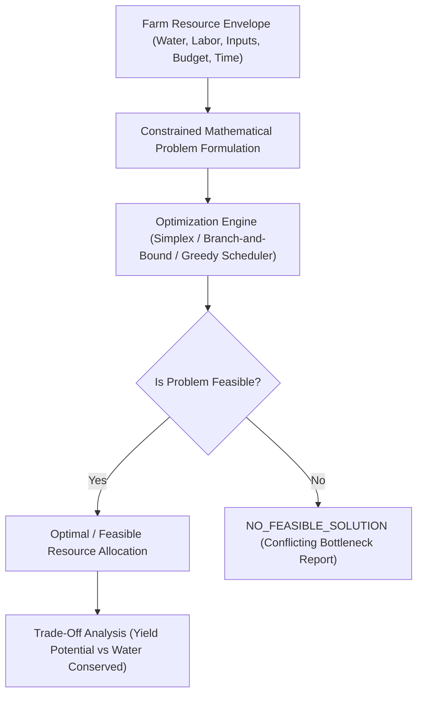

# ACREVIA — RESOURCE OPTIMIZATION ARCHITECTURE (PILLAR C: ACREVIA OPTIMIZE)
## Constrained Optimization, Feasible Set Evaluation & Explicit Bottleneck Identification

---

## 1. Overview & Ethical Boundaries
Resource optimization in smallholder farming is fundamentally about managing **scarcity and constraints**:
- A farmer has 1 borewell yielding 3,000 liters/hour shared across three plots (cotton, chilli, paddy).
- Hired labor is unavailable during regional harvest peaks.
- Working capital for top-dressing fertilizer is constrained.

ACREVIA Optimize evaluates feasible options within hard physical and economic boundaries:

> [!CAUTION]
> **INFEASIBILITY HONESTY MANDATE:**
> If a farmer's requested operational targets violate physical or biological constraints (e.g., water requirements exceed pump capacity), the optimizer **MUST return `NO_FEASIBLE_SOLUTION` and clearly identify the conflicting constraints**.
> Under no circumstances may the system relax constraints silently to produce an unrealistic plan.

---

## 2. Resource Vectors & Constraint Formulations



### 2.1 Multi-Plot Water Allocation Formulation
- **Decision Variables:** $x_{p,d} \ge 0$, volume of water allocated to plot $p$ on day $d$ (cubic meters).
- **Objective:** Minimize total water deficit penalty across all plots:
  $$\min \sum_{p=1}^{P} \sum_{d=1}^{D} w_p \cdot \max(0, ET_{c,p,d} - x_{p,d})$$
  Where $w_p$ is crop-stage economic vulnerability weight (e.g., chilli flowering $= 1.8$, vegetative cotton $= 1.0$).
- **Hard Constraints:**
  1. **Borewell Pump Capacity:**
     $$\sum_{p=1}^{P} x_{p,d} \le Q_{\max} \times H_{\text{power},d} \quad \forall d$$
     Where $Q_{\max}$ is pump yield ($m^3/\text{hr}$) and $H_{\text{power},d}$ is grid agricultural electricity availability (typically 7 to 9 hours in Telangana).
  2. **Soil Infiltration Capacity:**
     $$x_{p,d} \le I_{\max,p} \times \text{Area}_p \quad \forall p, d$$
  3. **Non-Negativity:** $x_{p,d} \ge 0$.

### 2.2 Input Budget Allocation Formulation
- **Decision Variables:** $y_i \in \{0, 1\}$ or integer units of input $i$ (e.g., Neem oil, Potassium nitrate, Trichoderma).
- **Hard Constraints:**
  $$\sum_{i=1}^{N} \text{Cost}_i \cdot y_i \le \text{Budget}_{\max}$$
  $$\sum_{i \in \text{Nitrogen}} N_{\text{content},i} \cdot y_i \le N_{\text{PJTSAU\_Recommended\_Ceiling}}$$

---

## 3. Solver Engine & Fallback Mechanism
1. **Primary Solver:** Pure Python / SciPy Linprog Simplex and Branch-and-Bound solver for linear and mixed-integer formulations.
2. **Deterministic Heuristic Fallback:** Rule-based priority queue (allocating scarce water first to crops in critical flowering stages, followed by vegetative stages).
3. **Execution Latency:** Bounded to $< 150\text{ ms}$, fully compatible with Vercel edge/serverless execution limits.

---

## 4. Infeasibility Diagnosis & Trade-Off Analysis
When no feasible solution exists:
- The system returns:
  ```json
  {
    "feasibility_status": "NO_FEASIBLE_SOLUTION",
    "conflicting_constraints": [
      {
        "constraint": "DAILY_PUMP_CAPACITY",
        "available": 24000,
        "required": 38000,
        "unit": "liters/day",
        "bottleneck": "Electricity supply (7 hrs) limits pump yield below total crop evapotranspiration."
      }
    ],
    "suggested_mitigations": [
      "Prioritize Plot 2 (Chilli in flowering stage); defer Plot 1 (Cotton in late vegetative) by 48 hours.",
      "Explore deficit irrigation for Cotton Plot 1 to reduce required volume by 30%."
    ]
  }
  ```
