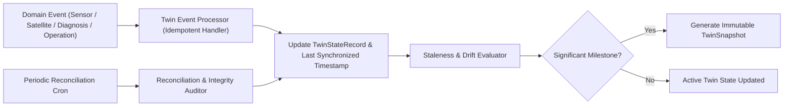

# ACREVIA — TWIN SYNCHRONIZATION AND RECONCILIATION
## Event-Driven State Updates, Stale-State Detection & Integrity Reconciliation

---

## 1. Synchronization Architecture & Event Pipeline
The ACREVIA Digital Twin must reflect ground and remote observations without recalculating the entire farm state upon every telemetry packet.

---

## 2. Supported Domain Synchronization Events

The `TwinSynchronizationEvent` ledger records all state mutation triggers:
- `FARM_UPDATED`: Farm metadata, acreage, or location privacy updated.
- `PLOT_GEOMETRY_SAVED`: WGS84 plot boundary updated or redrawn.
- `CROP_SEASON_CREATED`: New crop cycle initiated.
- `GROWTH_STAGE_UPDATED`: Vegetative, flowering, or boll/panicle stage advanced.
- `WEATHER_DATA_RECEIVED`: New hourly observation or 7-day forecast packet.
- `SATELLITE_OBSERVATION_CREATED`: New Sentinel-2 or Landsat-9 cloud-masked acquisition.
- `SENSOR_MEASUREMENT_RECEIVED`: In-situ probe reading (soil moisture, leaf wetness).
- `DIAGNOSIS_COMPLETED`: CropVision AI inference completed.
- `EXPERT_ASSESSMENT_CREATED`: ExpertConnect agronomist diagnosis submitted.
- `INTERVENTION_RECORDED`: Field operation (chemical, biological, irrigation) logged.
- `HARVEST_RECORDED`: Ground-truth harvest yield record logged.

---

## 3. Idempotency & Deduplication Protocol
- Every synchronization event carries a deterministic `event_hash`:
  $$\text{hash} = \text{SHA256}(\text{entity\_type} + \text{entity\_id} + \text{observed\_at} + \text{source\_reference})$$
- If an event with the same `event_hash` is received within a 24-hour window, the event processor logs a deduplication notice and exits with code 0 without duplicate database mutations.

---

## 4. Stale-State & Data Expiration Detection

Different agricultural observation streams decay at different biological rates. The twin classifies streams into freshness tiers:

| Stream Type | Maximum Freshness Window | Stale Condition Trigger | Degradation Action |
|---|---|---|---|
| **IoT Soil Moisture** | 6 Hours | No packet for $>6$ hours | Flag `SOIL_TELEMETRY_STALE`; fallback to regional evapotranspiration estimate with warning. |
| **Canopy Leaf Wetness** | 3 Hours | No packet for $>3$ hours | Pause real-time fungal spore risk model; fallback to regional humidity model. |
| **Satellite NDVI** | 15 Days | No clear-sky scene for $>15$ days | Flag `SATELLITE_OBSCURED_BY_CLOUDS`; rely on ground foliar photos. |
| **Weather Forecast** | 12 Hours | Forecast model age $>12$ hours | Fetch fresh meteorological grid update from provider. |
| **Crop Growth Stage** | 21 Days | No stage update or photo for $>21$ days | Prompt farmer to verify crop stage progression in PWA. |

---

## 5. Reconciliation Engine

In distributed and edge systems, asynchronous workers or network partitions can cause drift between raw relational tables and digital twin views.
The `TwinReconciliationService`:
1. **Audits Foreign Keys:** Verifies that all `plot_id`, `season_id`, and `sensor_id` references map to unarchived records.
2. **Rebuilds Twin State:** On demand (`POST /api/v1/twin/farms/{farm_id}/reconcile`), pulls latest verified records across all 10 domain tables, re-evaluates completeness, updates timestamps, and creates a reconciled snapshot.
3. **Discrepancy Reporting:** Generates an audit log of any orphaned or out-of-sequence records discovered during reconciliation.
