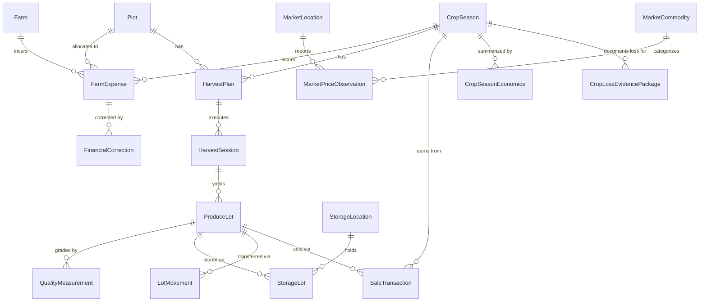

# ACREVIA — Database Schema and Domain Model Specification
**Target Database:** Neon PostgreSQL 16  
**Dialect:** PostgreSQL with SQLAlchemy 2.0 ORM Mappings  
**Stage:** 11

---

## 1. Entity Relationship Overview

---

## 2. Table Specifications

### 2.1. `farm_expenses`
- `id` (VARCHAR(36), PK): UUID.
- `farm_id` (VARCHAR(36), FK `farms.id`, indexed).
- `plot_id` (VARCHAR(36), FK `plots.id`, nullable).
- `crop_season_id` (VARCHAR(36), FK `crop_seasons.id`, nullable).
- `category` (VARCHAR(50), NOT NULL): `SEEDS`, `FERTILIZERS`, `PESTICIDES`, `LABOUR`, `MACHINERY`, `IRRIGATION`, `TRANSPORT`, `STORAGE`, `MISCELLANEOUS`.
- `description` (TEXT, NOT NULL).
- `amount` (NUMERIC(12, 2), NOT NULL).
- `currency` (VARCHAR(10), default `'INR'`).
- `quantity` (NUMERIC(10, 2), nullable).
- `unit` (VARCHAR(20), nullable): `KG`, `BAGS`, `LITRES`, `HOURS`, `DAYS`.
- `transaction_date` (DATE, NOT NULL).
- `payment_status` (VARCHAR(20), default `'PAID'`): `PAID`, `PENDING`, `PARTIAL`.
- `payment_method` (VARCHAR(30)): `CASH`, `UPI`, `BANK_TRANSFER`, `CREDIT_MERCHANT`.
- `vendor_name` (VARCHAR(100), nullable).
- `receipt_url` (VARCHAR(500), nullable).
- `created_by_user_id` (VARCHAR(36), nullable).
- `verification_state` (VARCHAR(30), default `'UNVERIFIED'`): `UNVERIFIED`, `PENDING_REVIEW`, `VERIFIED`, `FLAGGED`.
- `created_at` (TIMESTAMP WITH TIME ZONE, default `now()`).
- `updated_at` (TIMESTAMP WITH TIME ZONE, default `now()`).

### 2.2. `financial_corrections`
- `id` (VARCHAR(36), PK): UUID.
- `expense_id` (VARCHAR(36), FK `farm_expenses.id`, indexed, cascade delete).
- `previous_amount` (NUMERIC(12, 2), NOT NULL).
- `new_amount` (NUMERIC(12, 2), NOT NULL).
- `reason` (TEXT, NOT NULL).
- `corrected_by_user_id` (VARCHAR(36), nullable).
- `corrected_at` (TIMESTAMP WITH TIME ZONE, default `now()`).

### 2.3. `sale_transactions`
- `id` (VARCHAR(36), PK): UUID.
- `crop_season_id` (VARCHAR(36), FK `crop_seasons.id`, indexed).
- `lot_id` (VARCHAR(36), FK `produce_lots.id`, nullable).
- `buyer_name` (VARCHAR(100), NOT NULL).
- `buyer_type` (VARCHAR(50), default `'MANDI_TRADER'`): `MANDI_TRADER`, `VILLAGE_AGGREGATOR`, `COOPERATIVE`, `CORPORATE_PROCESSOR`.
- `quantity_sold` (NUMERIC(10, 2), NOT NULL).
- `unit` (VARCHAR(20), default `'QUINTAL'`).
- `price_per_unit` (NUMERIC(12, 2), NOT NULL).
- `gross_amount` (NUMERIC(12, 2), NOT NULL).
- `deductions_amount` (NUMERIC(12, 2), default 0.00).
- `net_amount` (NUMERIC(12, 2), NOT NULL).
- `sale_date` (DATE, NOT NULL).
- `payment_status` (VARCHAR(20), default `'PAID'`).
- `notes` (TEXT, nullable).
- `created_at` (TIMESTAMP WITH TIME ZONE, default `now()`).

### 2.4. `market_locations`
- `id` (VARCHAR(36), PK): UUID.
- `market_code` (VARCHAR(50), unique, NOT NULL).
- `market_name` (VARCHAR(100), NOT NULL).
- `district` (VARCHAR(100), NOT NULL).
- `state` (VARCHAR(100), default `'Telangana'`).
- `latitude` (NUMERIC(9, 6), NOT NULL).
- `longitude` (NUMERIC(9, 6), NOT NULL).
- `is_active` (BOOLEAN, default TRUE).

### 2.5. `market_commodities`
- `id` (VARCHAR(36), PK): UUID.
- `commodity_name` (VARCHAR(100), NOT NULL).
- `canonical_crop_id` (VARCHAR(50), NOT NULL).
- `variety_name` (VARCHAR(100), nullable).
- `grade` (VARCHAR(50), nullable).

### 2.6. `market_price_observations`
- `id` (VARCHAR(36), PK): UUID.
- `market_id` (VARCHAR(36), FK `market_locations.id`, indexed).
- `commodity_id` (VARCHAR(36), FK `market_commodities.id`, indexed).
- `min_price` (NUMERIC(10, 2), NOT NULL).
- `max_price` (NUMERIC(10, 2), NOT NULL).
- `modal_price` (NUMERIC(10, 2), NOT NULL).
- `price_unit` (VARCHAR(30), default `'INR_PER_QUINTAL'`).
- `arrival_quantity_quintals` (NUMERIC(10, 2), default 0.00).
- `observation_date` (DATE, NOT NULL, indexed).
- `source_provider` (VARCHAR(50), default `'AGMARKNET'`): `AGMARKNET`, `ENAM`, `TS_MARKETING`.
- `retrieved_at` (TIMESTAMP WITH TIME ZONE, default `now()`).

### 2.7. `harvest_plans`
- `id` (VARCHAR(36), PK): UUID.
- `plot_id` (VARCHAR(36), FK `plots.id`, indexed).
- `crop_season_id` (VARCHAR(36), FK `crop_seasons.id`, indexed).
- `planned_start_date` (DATE, NOT NULL).
- `planned_end_date` (DATE, NOT NULL).
- `estimated_quantity_quintals` (NUMERIC(10, 2), NOT NULL).
- `harvest_method` (VARCHAR(50), default `'MANUAL'`): `MANUAL`, `MECHANICAL`, `COMBINED`.
- `status` (VARCHAR(30), default `'PLANNED'`): `PLANNED`, `IN_PROGRESS`, `COMPLETED`, `CANCELLED`.
- `created_at` (TIMESTAMP WITH TIME ZONE, default `now()`).

### 2.8. `harvest_sessions`
- `id` (VARCHAR(36), PK): UUID.
- `plot_id` (VARCHAR(36), FK `plots.id`, indexed).
- `crop_season_id` (VARCHAR(36), FK `crop_seasons.id`, indexed).
- `harvest_plan_id` (VARCHAR(36), FK `harvest_plans.id`, nullable).
- `picking_number` (INTEGER, default 1).
- `harvest_date` (DATE, NOT NULL).
- `harvested_quantity` (NUMERIC(10, 2), NOT NULL).
- `unit` (VARCHAR(20), default `'QUINTAL'`).
- `quantity_type` (VARCHAR(30), default `'MEASURED'`): `MEASURED`, `ESTIMATED_QUANTITY`.
- `loss_quantity` (NUMERIC(10, 2), default 0.00).
- `notes` (TEXT, nullable).
- `recorded_by_user_id` (VARCHAR(36), nullable).
- `created_at` (TIMESTAMP WITH TIME ZONE, default `now()`).

### 2.9. `produce_quality_profiles`
- `id` (VARCHAR(36), PK): UUID.
- `crop_id` (VARCHAR(50), NOT NULL, indexed).
- `standard_name` (VARCHAR(100), default `'AGMARK_TELANGANA'`).
- `grade_definitions_json` (TEXT, NOT NULL).

### 2.10. `quality_measurements`
- `id` (VARCHAR(36), PK): UUID.
- `session_id` (VARCHAR(36), FK `harvest_sessions.id`, nullable).
- `lot_id` (VARCHAR(36), FK `produce_lots.id`, nullable, indexed).
- `parameter_name` (VARCHAR(50), NOT NULL): `MOISTURE_PCT`, `STAPLE_LENGTH_MM`, `MICRONAIRE`, `ASTA_COLOR`, `FOREIGN_MATTER_PCT`, `BROKEN_GRAIN_PCT`.
- `measured_value` (NUMERIC(8, 2), NOT NULL).
- `unit` (VARCHAR(20), NOT NULL).
- `measurement_method` (VARCHAR(50), default `'MEASURED_DIGITAL_SENSOR'`): `MEASURED_DIGITAL_SENSOR`, `VERIFIED_LAB_ASSAY`, `FARMER_VISUAL_ESTIMATE`.
- `instrument_details` (VARCHAR(100), nullable).
- `measured_at` (TIMESTAMP WITH TIME ZONE, default `now()`).

### 2.11. `storage_locations`
- `id` (VARCHAR(36), PK): UUID.
- `farm_id` (VARCHAR(36), FK `farms.id`, indexed).
- `name` (VARCHAR(100), NOT NULL).
- `storage_type` (VARCHAR(50), NOT NULL): `ON_FARM_SHED`, `HERMETIC_BAGS`, `COMMERCIAL_COLD_STORAGE`, `CWC_TSWC_WAREHOUSE`.
- `capacity_quintals` (NUMERIC(10, 2), NOT NULL).
- `district` (VARCHAR(100), NOT NULL).
- `is_temperature_controlled` (BOOLEAN, default FALSE).

### 2.12. `storage_lots`
- `id` (VARCHAR(36), PK): UUID.
- `lot_id` (VARCHAR(36), FK `produce_lots.id`, indexed).
- `storage_location_id` (VARCHAR(36), FK `storage_locations.id`, indexed).
- `quantity_stored` (NUMERIC(10, 2), NOT NULL).
- `unit` (VARCHAR(20), default `'QUINTAL'`).
- `entry_date` (DATE, NOT NULL).
- `exit_date` (DATE, nullable).
- `current_status` (VARCHAR(30), default `'STORED'`): `STORED`, `DISPATCHED`, `LOSS_DISCARDED`.

### 2.13. `produce_lots`
- `id` (VARCHAR(36), PK): UUID.
- `lot_code` (VARCHAR(60), unique, NOT NULL, indexed).
- `qr_token` (VARCHAR(100), unique, NOT NULL, indexed).
- `farm_id` (VARCHAR(36), FK `farms.id`, indexed).
- `plot_id` (VARCHAR(36), FK `plots.id`, indexed).
- `crop_season_id` (VARCHAR(36), FK `crop_seasons.id`, indexed).
- `crop_id` (VARCHAR(50), NOT NULL).
- `variety_name` (VARCHAR(100), nullable).
- `harvest_date` (DATE, NOT NULL).
- `initial_quantity` (NUMERIC(10, 2), NOT NULL).
- `remaining_quantity` (NUMERIC(10, 2), NOT NULL).
- `unit` (VARCHAR(20), default `'QUINTAL'`).
- `current_status` (VARCHAR(30), default `'ACTIVE'`): `ACTIVE`, `STORED`, `PARTIALLY_SOLD`, `COMPLETELY_SOLD`, `EXPIRED`.
- `created_at` (TIMESTAMP WITH TIME ZONE, default `now()`).

### 2.14. `lot_movements`
- `id` (VARCHAR(36), PK): UUID.
- `lot_id` (VARCHAR(36), FK `produce_lots.id`, indexed).
- `movement_type` (VARCHAR(30), NOT NULL): `HARVEST_IN`, `STORAGE_ENTRY`, `TRANSFER`, `SALE`, `SPLIT`, `DISCARD`.
- `source_location` (VARCHAR(100), NOT NULL).
- `destination_location` (VARCHAR(100), NOT NULL).
- `quantity_transferred` (NUMERIC(10, 2), NOT NULL).
- `unit` (VARCHAR(20), default `'QUINTAL'`).
- `actor_name` (VARCHAR(100), NOT NULL).
- `movement_timestamp` (TIMESTAMP WITH TIME ZONE, default `now()`).
- `notes` (TEXT, nullable).

### 2.15. `crop_season_economics`
- `id` (VARCHAR(36), PK): UUID.
- `crop_season_id` (VARCHAR(36), FK `crop_seasons.id`, unique, indexed).
- `total_expenses` (NUMERIC(12, 2), NOT NULL).
- `gross_revenue` (NUMERIC(12, 2), NOT NULL).
- `net_realization` (NUMERIC(12, 2), NOT NULL).
- `total_harvest_quantity` (NUMERIC(10, 2), NOT NULL).
- `total_sold_quantity` (NUMERIC(10, 2), NOT NULL).
- `unit` (VARCHAR(20), default `'QUINTAL'`).
- `cost_per_unit` (NUMERIC(10, 2), NOT NULL).
- `net_margin_per_unit` (NUMERIC(10, 2), NOT NULL).
- `data_completeness_pct` (NUMERIC(5, 2), NOT NULL).
- `calculated_at` (TIMESTAMP WITH TIME ZONE, default `now()`).

### 2.16. `crop_loss_evidence_packages`
- `id` (VARCHAR(36), PK): UUID.
- `farm_id` (VARCHAR(36), FK `farms.id`, indexed).
- `plot_id` (VARCHAR(36), FK `plots.id`, indexed).
- `crop_season_id` (VARCHAR(36), FK `crop_seasons.id`, indexed).
- `incident_date` (DATE, NOT NULL).
- `incident_type` (VARCHAR(50), NOT NULL): `EXCESS_RAINFALL`, `CYCLONE_WIND`, `HAILSTORM`, `EXTREME_DROUGHT`, `PEST_OUTBREAK`.
- `package_payload_json` (TEXT, NOT NULL).
- `package_hash` (VARCHAR(64), NOT NULL).
- `generated_at` (TIMESTAMP WITH TIME ZONE, default `now()`).
