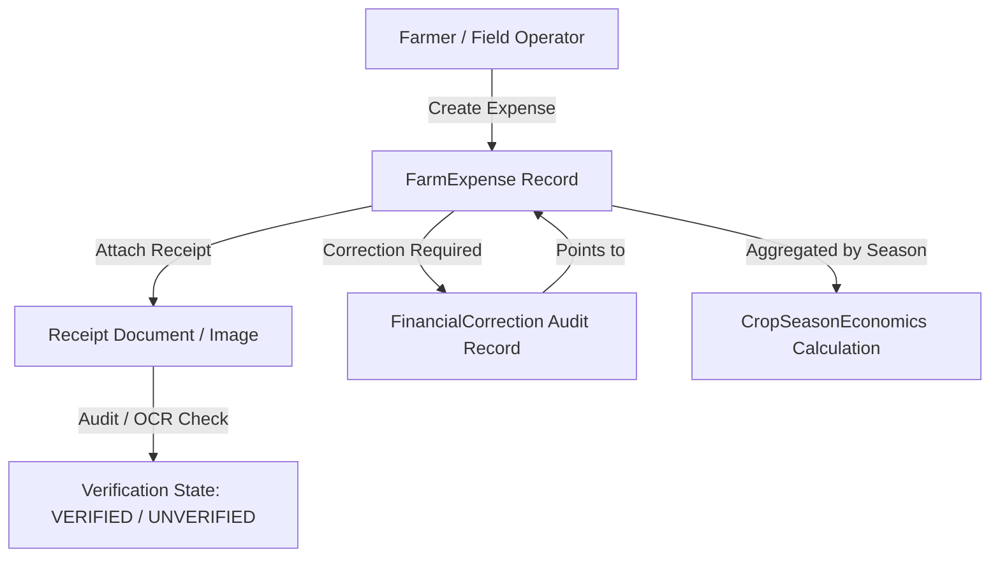

# ACREVIA — Farm Financial Ledger Architecture
**Subsystem:** Pillar A — ACREVIA Ledger  
**Primary Objective:** Precise, auditable, decimal-safe farm financial accounting for smallholder and commercial operations in Telangana.

---

## 1. Architectural Scope & Principles

The **Farm Financial Ledger** delivers structured expense recording and revenue tracking tailored to Indian agricultural realities. Unlike generic bookkeeping software, it binds monetary entries directly to agricultural entities: `Farm`, `Plot`, and `CropSeason`.

### Key Principles:
1. **Decimal Precision:** All financial figures are represented using `Numeric(12, 2)` in PostgreSQL and `Decimal` in Python. Float rounding errors are completely prohibited.
2. **Standardized Ag-Expense Categories:** Aligned with ICAR/CACP (Commission for Agricultural Costs and Prices) cost concepts ($A_1, A_2, B_1, B_2, C_1, C_2$):
   - `SEEDS`: Certified seeds, saplings, nursery preparation.
   - `FERTILIZERS`: Chemical fertilizers (Urea, DAP, MOP), organic manure, bio-fertilizers.
   - `PESTICIDES`: Fungicides, insecticides, herbicides, biocontrol agents.
   - `LABOUR`: Sowing, weeding, spraying, picking/harvesting, bagging. Separated into hired human labour and family labour accounting.
   - `MACHINERY`: Tractor rental, harvester hire, fuel, sprayer maintenance.
   - `IRRIGATION`: Electricity tariffs, canal water cess, diesel pump fuel, drip maintenance.
   - `TRANSPORT`: Farm-gate to mandi transit, loading/unloading (*hamali*).
   - `STORAGE`: Cold storage rent, warehouse booking charges.
   - `MISCELLANEOUS`: Packaging bags, twine, interest on operational credit.
3. **Receipt Storage & Verification States:**
   - Expenses can link to receipt images or digital invoices (`receipt_url`).
   - Receipts undergo validation: `PENDING_REVIEW`, `VERIFIED`, `UNVERIFIED`, `REJECTED`.
4. **Correction Audit Trail (Immutability & Traceability):**
   - Financial entries are not silently overwritten.
   - Any modification creates a linked `FinancialCorrection` record containing `previous_amount`, `new_amount`, `reason`, `corrected_by_user_id`, and `corrected_at`.

---

## 2. Relational Schema & State Flow

### Verification States:
- `UNVERIFIED`: Self-reported without documentary proof.
- `PENDING_REVIEW`: Receipt uploaded, awaiting automated OCR or field officer review.
- `VERIFIED`: Validated with verified vendor invoice or authorized voucher.
- `FLAGGED`: Discrepancy detected (e.g., unit cost wildly exceeds regional market norms).

---

## 3. Revenue & Sales Transaction Tracking

Sale transactions capture the revenue side of the farm ledger:
- Linked to `CropSeason` and optionally a specific `ProduceLot`.
- Captures `buyer_name`, `quantity_sold`, `unit` (`QUINTAL`, `KG`), `price_per_unit`, `gross_amount`.
- Records mandatory deductions: Mandi commission/cess, hamali (handling charges), weighing fees, transport deductions.
- Computes `net_amount = gross_amount - deductions_amount`.
