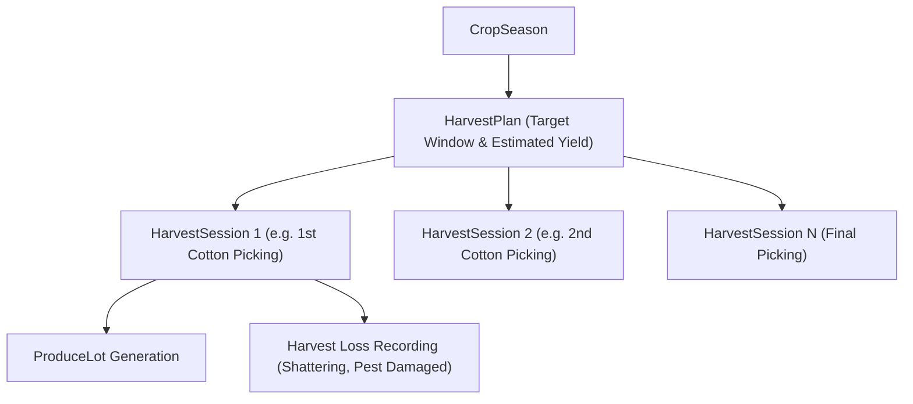

# ACREVIA — Harvest Management Architecture
**Subsystem:** Pillar C — ACREVIA Harvest  
**Primary Objective:** End-to-end management of harvest planning, picking sessions, quantity accounting, and loss tracking.

---

## 1. Domain Dynamics of Crop Harvesting in Telangana

Harvesting practices differ significantly across target crops:
1. **Cotton (*Gossypium hirsutum*):**
   - Harvested through **multiple pickings** (typically 3 to 4 pickings over 60–90 days).
   - *1st Picking:* Cleanest, longest staple, highest market value.
   - *Subsequent Pickings:* Potential trash/leaf contamination, lower moisture, varying micronaire.
   - Tracking must support multiple sessions per season with picking indices (1st, 2nd, 3rd, final).
2. **Rice (*Oryza sativa*):**
   - Typically **single combined harvesting** or 1–2 phase manual cutting and mechanical threshing.
   - Moisture management is paramount (ideal harvest moisture: 20–22%, safe storage moisture: 12–14%).
   - Immediate post-harvest drying is required to prevent fungal discoloration and aflatoxin risks.
3. **Chilli (*Capsicum annuum*):**
   - Multi-stage manual picking of ripe red pods (3–5 pickings).
   - Followed by sun-drying on drying yards (*kallam*) or solar tunnel dryers.
   - Significant drying weight loss (~70–75% moisture reduction from fresh red ripe pod to dry commercial chilli).

---

## 2. Harvest Data Model & Session Tracking

### Key Harvest Tracking Entities:
- **`HarvestPlan`:**
  - Binds to `Plot` and `CropSeason`.
  - Specifies `planned_start_date`, `planned_end_date`, `estimated_quantity_quintals`, `harvest_method` (`MANUAL_LABOUR`, `MECHANICAL_HARVESTER`, `COMBINED`).
- **`HarvestSession`:**
  - Captures actual operational picking events.
  - Fields: `harvest_date`, `harvested_quantity`, `unit` (`QUINTAL`, `KG`, `BAGS`), `quantity_type` (`MEASURED` via weighing scale vs. `ESTIMATED_QUANTITY` by bag count).
  - `loss_quantity`: Harvest and field losses (e.g., boll rot, fallen pods, shattering).
  - `labour_count` & `machinery_hours` for operational cost linkage.
  - Generates linked `ProduceLot`.
