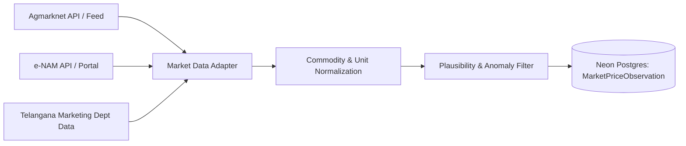

# ACREVIA — Agricultural Market Intelligence Architecture
**Subsystem:** Pillar B — ACREVIA Market  
**Primary Objective:** Transparent, accurate, and multi-mandi commodity market intelligence for Telangana crops (Cotton, Rice, Chilli).

---

## 1. Domain Overview & Mandi Dynamics

Telangana features major agricultural marketing committees (APMC mandis) known for specific crops:
- **Warangal (Enumamula Mandi):** Asia's second-largest agricultural market, primary trading hub for Red Chilli (*Teja*, *Guntur sannam*), Cotton, and Paddy.
- **Khammam Mandi:** Leading market for Cotton and Chilli.
- **Karimnagar / Jagtial:** Paddy (Rice) and Maize markets.
- **Suryapet / Nalgonda:** Paddy procurement and trading centers.
- **Adilabad:** Long-staple cotton hub.

Agricultural prices vary dynamically across mandis based on arrival quantities, moisture content, staple length/pungency, and buyer demand.

---

## 2. Market Data Ingestion & Normalization

### Normalization Rules:
1. **Canonical Crop Mapping:**
   - Cotton: mapped to canonical ID `cotton`, distinguishing Kapas (seed cotton) vs. Lint.
   - Rice/Paddy: mapped to canonical ID `rice`, distinguishing Common (Grade A) vs. Superfine / Sona Masuri.
   - Chilli: mapped to canonical ID `chilli`, distinguishing Dry Red Chilli (*Teja*, *Fatki*, *Wonder Hot*).
2. **Price Representation:**
   - Standard unit: **INR per Quintal** (1 Quintal = 100 kg).
   - Price metrics tracked per day per market:
     - `min_price`: Lowest recorded modal transaction.
     - `max_price`: Premium lot transaction.
     - `modal_price`: Most frequent transaction price (the true benchmark).
3. **Arrival Volume Tracking:**
   - Recorded in Quintals or Metric Tonnes.
   - High arrival spikes correlate with downward price pressure during peak harvest windows.

---

## 3. Comparability & Distance Calculation

When presenting market comparisons to farmers:
- Each mandi record includes its geospatial coordinates (`latitude`, `longitude`).
- Haversine distance is computed from the farmer's plot to candidate mandis.
- Transport cost estimation model:
  $$\text{Transport Cost (INR/Quintal)} = \text{Base Loading Rate} + (\text{Distance km} \times \text{Per-Km Rate per Quintal})$$
- Net Realization at Mandi $M$:
  $$\text{Net Realization} = \text{Modal Price}_M - \text{Transport Cost}_M - \text{Mandi Cess \& Hamali}_M$$
- Clearly displays that physical quality inspection at the mandi determines final bid price.
