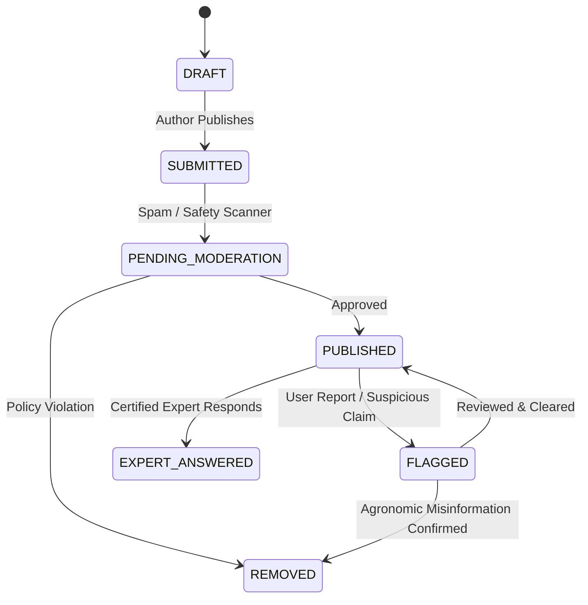

# ACREVIA — Connect Architecture (Agricultural Collaboration Network)
**Subsystem:** Pillar A — ACREVIA Connect  
**Primary Objective:** A structured, moderated, evidence-aware collaboration environment connecting farmers, certified experts, and agricultural organizations.

---

## 1. Domain Overview & Non-Social-Media Philosophy

ACREVIA Connect is deliberately designed as a **mission-oriented agricultural collaboration network**, not an engagement-maximizing social media feed:
- **No Algorithmic Engagement Churn:** Content is organized chronologically and by explicit agronomic taxonomy (Crop, Practice, Geography, and Topic), never by virality or controversy algorithms.
- **Clear Information Provenance:** Every post and response clearly displays its author trust tier (`FARMER_REPORTED`, `EXPERT_REVIEWED`, `OFFICIALLY_SOURCED`, `RESEARCH_VALIDATED`).
- **Helpful Voting $\ne$ Scientific Truth:** Community upvotes indicate peer utility, not scientific correctness. Expert replies carry cryptographic agronomist badges derived from ExpertConnect credentials.

---

## 2. Community Spaces & Taxonomy

Communities are established around structured agricultural domains:
1. **Crop-Specific Communities:**
   - *Telangana Cotton Cultivators:* Boll management, pink bollworm monitoring, picking schedules.
   - *Paddy / Rice Systems:* Direct seeded rice (DSR), nursery management, water-saving practices.
   - *Red Chilli Growers:* Sucking pest control, drying yard practices, cold storage planning.
2. **Practice & Environmental Communities:**
   - *Soil Health & Organic Carbon:* Farmyard manure, vermicompost, cover cropping.
   - *Micro-Irrigation & Water Conservation:* Drip scheduling, borewell recharge.
3. **Collective & Training Communities:**
   - *FPO Knowledge Exchange:* Telangana farmer collectives sharing operational experience.
   - *KVK & Extension Learning Circles:* Formal training and Q&A spaces.

---

## 3. Post Types & Lifecycle

### Supported Post Categories:
- `QUESTION`: Farmer seeking advice on symptoms, inputs, or crop management.
- `FIELD_EXPERIENCE`: Farmer sharing field observations or technique results.
- `OBSERVATION`: Field scouting notes (phenology, pest arrival, weather impact).
- `KNOWLEDGE_CONTRIBUTION`: Substantive agricultural explainer (routes to Commons).
- `EDUCATIONAL_RESOURCE`: Extension guide or university advisory.
- `EVENT_ANNOUNCEMENT`: Training session or field demonstration.
- `EXPERT_RESPONSE`: Certified agronomist advisory reply.

---

## 4. Moderation & Misinformation Defense

- **Automated Scanning:** Pre-publish filters detect commercial solicitations, pesticide misuse (unregistered chemicals), abusive language, and spam URLs.
- **Misinformation Reporting:** Users and agronomists can flag posts under specialized categories:
  - `DANGEROUS_CHEMICAL_ADVICE`: Violations of CIBRC recommendations or dangerous tank mixtures.
  - `UNSUPPORTED_OUTBREAK_CLAIM`: Rumors of widespread epidemics lacking diagnostic evidence.
  - `FABRICATED_CREDENTIALS`: Unverified users posing as agricultural scientists.
  - `COMMERCIAL_SOLICITATION`: Aggressive private pesticide dealership sales.
- **Action Escalation:** Flagged posts are temporarily hidden pending review by community moderators or ExpertConnect agronomists.
