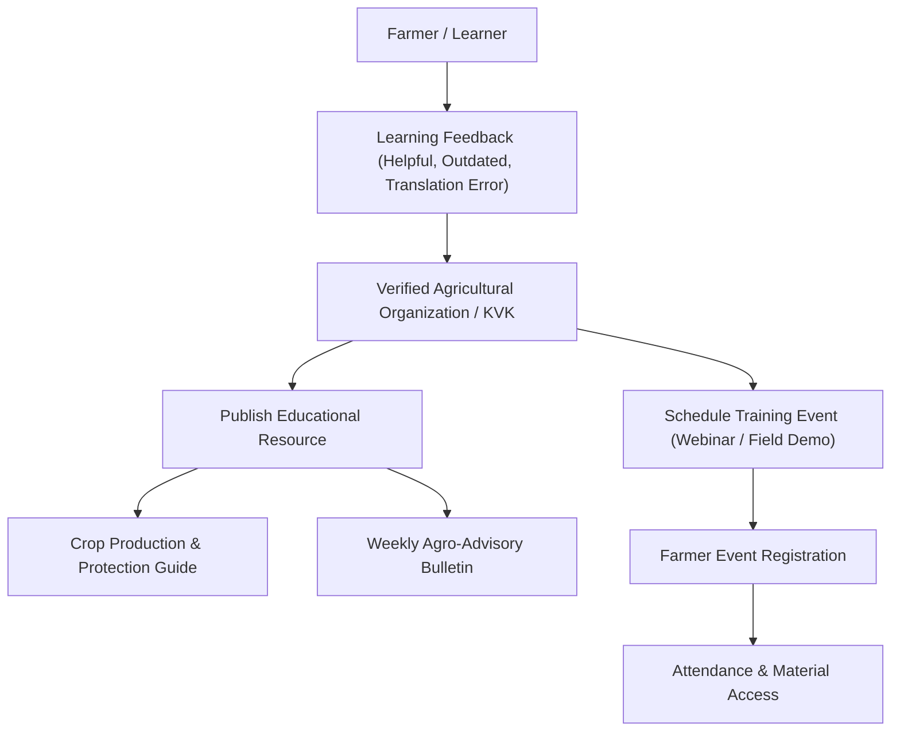

# ACREVIA — Agricultural Extension & Learning Architecture
**Subsystem:** Pillar E — ACREVIA Extension  
**Primary Objective:** A structured learning and extension coordination layer delivering verified agronomic guides, university advisories, and interactive training events.

---

## 1. Domain Overview & Institutional Integrity

Agricultural extension in India relies on certified Krishi Vigyan Kendras (KVKs), State Agricultural Universities (PJTSAU in Telangana), and State Department of Agriculture advisories.

### Platform Integrity Rules:
- **No Fabricated Affiliations:** An organization cannot display "PJTSAU Verified" or "ICAR Certified" without formal institutional verification documents.
- **Clear Attribution:** Every educational resource displays the publishing author, parent organization, original publication date, and review status (`VERIFIED_OFFICIAL`, `PEER_REVIEWED`, `COMMUNITY_RESOURCE`).

---

## 2. Extension Resources & Training Events

### Resource Types:
- `CROP_GUIDE`: Comprehensive package of practices (e.g. High Density Planting System [HDPS] Cotton).
- `EDUCATIONAL_ARTICLE`: Best practices on micro-irrigation, fertilizer schedules, or biological control.
- `GOVERNMENT_ADVISORY`: Official weather alerts and pest advisories from PJTSAU / IMD.
- `FAQ`: Standardized answers to common regional farmer inquiries.

### Farmer Feedback Channels:
Farmers can provide constructive feedback on learning resources (`HELPFUL`, `NOT_HELPFUL`, `DIFFICULT_TO_UNDERSTAND`, `OUTDATED`, `INCORRECT_TRANSLATION`), driving continuous improvements in extension materials.
