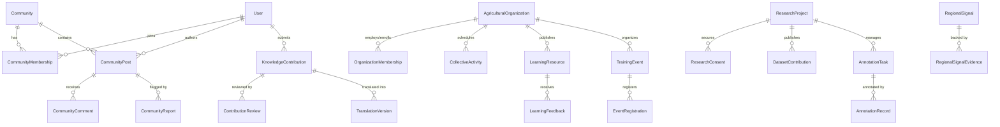

# ACREVIA — Stage 12 Database Schema and Domain Model
**Target Database:** Neon PostgreSQL 16 + pgvector  
**Dialect:** PostgreSQL with SQLAlchemy 2.0 ORM Mappings  
**Stage:** 12

---

## 1. Domain Entities Architecture

---

## 2. Table Specifications

### 2.1. `communities`
- `id` (VARCHAR(36), PK): UUID.
- `name` (VARCHAR(100), NOT NULL).
- `slug` (VARCHAR(100), unique, index).
- `description` (TEXT, NOT NULL).
- `category` (VARCHAR(50), NOT NULL): `CROP`, `TOPIC`, `GEOGRAPHY`, `PRACTICE`.
- `crop_id` (VARCHAR(50), nullable, index).
- `district` (VARCHAR(100), nullable).
- `is_moderated` (BOOLEAN, default TRUE).
- `created_by_user_id` (VARCHAR(36), FK `users.id`, nullable).
- `created_at` (TIMESTAMP WITH TIME ZONE, default `now()`).

### 2.2. `community_memberships`
- `id` (VARCHAR(36), PK): UUID.
- `community_id` (VARCHAR(36), FK `communities.id`, ondelete `CASCADE`, index).
- `user_id` (VARCHAR(36), FK `users.id`, ondelete `CASCADE`, index).
- `role` (VARCHAR(50), default `'MEMBER'`): `MEMBER`, `MODERATOR`, `EXPERT_ADVISOR`.
- `joined_at` (TIMESTAMP WITH TIME ZONE, default `now()`).

### 2.3. `community_posts`
- `id` (VARCHAR(36), PK): UUID.
- `community_id` (VARCHAR(36), FK `communities.id`, ondelete `CASCADE`, index).
- `author_id` (VARCHAR(36), FK `users.id`, ondelete `CASCADE`, index).
- `post_type` (VARCHAR(50), NOT NULL): `QUESTION`, `FIELD_EXPERIENCE`, `OBSERVATION`, `KNOWLEDGE_CONTRIBUTION`, `EDUCATIONAL_RESOURCE`, `EVENT_ANNOUNCEMENT`, `EXPERT_RESPONSE`.
- `title` (VARCHAR(200), NOT NULL).
- `content` (TEXT, NOT NULL).
- `language` (VARCHAR(10), default `'en'`).
- `crop_id` (VARCHAR(50), nullable, index).
- `growth_stage` (VARCHAR(50), nullable).
- `visibility` (VARCHAR(30), default `'COMMUNITY_PUBLIC'`): `COMMUNITY_PUBLIC`, `RESTRICTED_MEMBERS`, `EXPERT_ONLY`.
- `moderation_status` (VARCHAR(30), default `'APPROVED'`): `PENDING`, `APPROVED`, `FLAGGED`, `REMOVED`.
- `is_expert_reviewed` (BOOLEAN, default FALSE).
- `helpful_count` (INTEGER, default 0).
- `created_at` (TIMESTAMP WITH TIME ZONE, default `now()`).
- `updated_at` (TIMESTAMP WITH TIME ZONE, default `now()`).

### 2.4. `community_comments`
- `id` (VARCHAR(36), PK): UUID.
- `post_id` (VARCHAR(36), FK `community_posts.id`, ondelete `CASCADE`, index).
- `author_id` (VARCHAR(36), FK `users.id`, ondelete `CASCADE`, index).
- `content` (TEXT, NOT NULL).
- `is_expert_reply` (BOOLEAN, default FALSE).
- `is_helpful` (BOOLEAN, default FALSE).
- `moderation_status` (VARCHAR(30), default `'APPROVED'`).
- `created_at` (TIMESTAMP WITH TIME ZONE, default `now()`).

### 2.5. `community_reports`
- `id` (VARCHAR(36), PK): UUID.
- `post_id` (VARCHAR(36), FK `community_posts.id`, ondelete `CASCADE`, nullable, index).
- `comment_id` (VARCHAR(36), FK `community_comments.id`, ondelete `CASCADE`, nullable, index).
- `reported_by_user_id` (VARCHAR(36), FK `users.id`, ondelete `CASCADE`, index).
- `reason_category` (VARCHAR(50), NOT NULL): `SPAM`, `MISINFORMATION`, `DANGEROUS_ADVICE`, `HARASSMENT`, `COMMERCIAL_SOLICITATION`.
- `details` (TEXT, nullable).
- `status` (VARCHAR(30), default `'PENDING'`): `PENDING`, `RESOLVED`, `DISMISSED`.
- `reviewed_by_user_id` (VARCHAR(36), nullable).
- `created_at` (TIMESTAMP WITH TIME ZONE, default `now()`).

### 2.6. `knowledge_contributions`
- `id` (VARCHAR(36), PK): UUID.
- `contributor_id` (VARCHAR(36), FK `users.id`, ondelete `CASCADE`, index).
- `contribution_type` (VARCHAR(50), NOT NULL): `EXPLANATION`, `TERMINOLOGY`, `OBSERVATION`, `EXPERT_ARTICLE`, `ADVISORY`, `TRANSLATION_CORRECTION`.
- `title` (VARCHAR(200), NOT NULL).
- `description` (TEXT, NOT NULL).
- `original_language` (VARCHAR(10), default `'en'`).
- `crop_id` (VARCHAR(50), nullable, index).
- `geographic_scope` (VARCHAR(100), default `'Telangana'`).
- `growth_stage` (VARCHAR(50), nullable).
- `evidence_references_json` (TEXT, default `'[]'`).
- `usage_permission` (VARCHAR(50), default `'CC_BY_SA_4_0'`).
- `status` (VARCHAR(50), default `'SUBMITTED'`): `DRAFT`, `SUBMITTED`, `MODERATION_PENDING`, `AGRICULTURAL_REVIEW`, `LANGUAGE_REVIEW`, `APPROVED`, `REJECTED`, `PUBLISHED`, `ARCHIVED`.
- `assigned_expert_id` (VARCHAR(36), nullable).
- `approved_by_user_id` (VARCHAR(36), nullable).
- `krishi_brain_ingested` (BOOLEAN, default FALSE).
- `krishi_brain_doc_id` (VARCHAR(36), nullable).
- `created_at` (TIMESTAMP WITH TIME ZONE, default `now()`).
- `updated_at` (TIMESTAMP WITH TIME ZONE, default `now()`).

### 2.7. `contribution_reviews`
- `id` (VARCHAR(36), PK): UUID.
- `contribution_id` (VARCHAR(36), FK `knowledge_contributions.id`, ondelete `CASCADE`, index).
- `reviewer_id` (VARCHAR(36), FK `users.id`, ondelete `CASCADE`, index).
- `reviewer_role` (VARCHAR(50), NOT NULL): `EXPERT_AGRONOMIST`, `LANGUAGE_SPECIALIST`, `MODERATOR`.
- `decision` (VARCHAR(30), NOT NULL): `APPROVE`, `REJECT`, `REQUEST_REVISION`.
- `comments` (TEXT, NOT NULL).
- `scientific_rating` (INTEGER, default 5).
- `safety_assessment` (TEXT, nullable).
- `reviewed_at` (TIMESTAMP WITH TIME ZONE, default `now()`).

### 2.8. `translation_versions`
- `id` (VARCHAR(36), PK): UUID.
- `contribution_id` (VARCHAR(36), FK `knowledge_contributions.id`, ondelete `CASCADE`, index).
- `target_language` (VARCHAR(10), NOT NULL): `te`, `en`, `hi`.
- `translated_title` (VARCHAR(200), NOT NULL).
- `translated_content` (TEXT, NOT NULL).
- `is_native_reviewed` (BOOLEAN, default FALSE).
- `reviewer_id` (VARCHAR(36), nullable).
- `created_at` (TIMESTAMP WITH TIME ZONE, default `now()`).

### 2.9. `agricultural_organizations`
- `id` (VARCHAR(36), PK): UUID.
- `name` (VARCHAR(150), NOT NULL).
- `org_type` (VARCHAR(50), NOT NULL): `FPO`, `COOPERATIVE`, `FARMER_GROUP`, `TRAINING_GROUP`, `RESEARCH_PARTICIPANT_GROUP`.
- `registration_number` (VARCHAR(100), nullable).
- `state` (VARCHAR(100), default `'Telangana'`).
- `district` (VARCHAR(100), NOT NULL).
- `description` (TEXT, nullable).
- `contact_email` (VARCHAR(100), nullable).
- `contact_phone` (VARCHAR(20), nullable).
- `verification_status` (VARCHAR(50), default `'APPLICATION_SUBMITTED'`): `APPLICATION_SUBMITTED`, `UNDER_REVIEW`, `APPROVED`, `REJECTED`, `SUSPENDED`.
- `verified_by_user_id` (VARCHAR(36), nullable).
- `created_at` (TIMESTAMP WITH TIME ZONE, default `now()`).

### 2.10. `organization_memberships`
- `id` (VARCHAR(36), PK): UUID.
- `organization_id` (VARCHAR(36), FK `agricultural_organizations.id`, ondelete `CASCADE`, index).
- `user_id` (VARCHAR(36), FK `users.id`, ondelete `CASCADE`, index).
- `org_role` (VARCHAR(50), default `'MEMBER'`): `ORGANIZATION_ADMIN`, `GROUP_COORDINATOR`, `MEMBER`, `ADVISOR`, `OBSERVER`.
- `is_active` (BOOLEAN, default TRUE).
- `joined_at` (TIMESTAMP WITH TIME ZONE, default `now()`).

### 2.11. `collective_activities`
- `id` (VARCHAR(36), PK): UUID.
- `organization_id` (VARCHAR(36), FK `agricultural_organizations.id`, ondelete `CASCADE`, index).
- `created_by_user_id` (VARCHAR(36), FK `users.id`, ondelete `SET NULL`, nullable).
- `activity_type` (VARCHAR(50), NOT NULL): `SHARED_CALENDAR`, `TRAINING_SESSION`, `GROUP_ANNOUNCEMENT`, `COLLECTIVE_OBSERVATION`, `RESOURCE_COORDINATION`.
- `title` (VARCHAR(200), NOT NULL).
- `description` (TEXT, NOT NULL).
- `target_date` (DATE, NOT NULL).
- `status` (VARCHAR(30), default `'PLANNED'`): `PLANNED`, `IN_PROGRESS`, `COMPLETED`, `CANCELLED`.
- `created_at` (TIMESTAMP WITH TIME ZONE, default `now()`).

### 2.12. `research_projects`
- `id` (VARCHAR(36), PK): UUID.
- `title` (VARCHAR(200), NOT NULL).
- `lead_researcher_id` (VARCHAR(36), FK `users.id`, ondelete `CASCADE`, index).
- `institution_name` (VARCHAR(150), NOT NULL).
- `research_objectives` (TEXT, NOT NULL).
- `supported_crops_json` (TEXT, default `'["cotton", "rice", "chilli"]'`).
- `geographic_scope` (VARCHAR(100), default `'Telangana'`).
- `project_status` (VARCHAR(30), default `'ACTIVE'`): `ACTIVE`, `COMPLETED`, `PAUSED`.
- `publication_references_json` (TEXT, default `'[]'`).
- `created_at` (TIMESTAMP WITH TIME ZONE, default `now()`).

### 2.13. `research_consents`
- `id` (VARCHAR(36), PK): UUID.
- `project_id` (VARCHAR(36), FK `research_projects.id`, ondelete `CASCADE`, index).
- `farmer_id` (VARCHAR(36), FK `users.id`, ondelete `CASCADE`, index).
- `consent_scope` (VARCHAR(50), NOT NULL): `OBSERVATIONS_ONLY`, `ANNOTATED_IMAGES`, `SENSOR_DATA`, `HARVEST_METRICS`, `FULL_RESEARCH`.
- `is_active` (BOOLEAN, default TRUE).
- `consent_version` (VARCHAR(20), default `'1.0'`).
- `granted_at` (TIMESTAMP WITH TIME ZONE, default `now()`).
- `revoked_at` (TIMESTAMP WITH TIME ZONE, nullable).

### 2.14. `dataset_contributions`
- `id` (VARCHAR(36), PK): UUID.
- `project_id` (VARCHAR(36), FK `research_projects.id`, ondelete `CASCADE`, index).
- `contributor_id` (VARCHAR(36), FK `users.id`, ondelete `CASCADE`, index).
- `dataset_name` (VARCHAR(150), NOT NULL).
- `crop_id` (VARCHAR(50), NOT NULL).
- `sample_count` (INTEGER, default 0).
- `data_type` (VARCHAR(50), NOT NULL): `CROP_IMAGES`, `OBSERVATIONS`, `SENSOR_TELEMETRY`.
- `split_type` (VARCHAR(20), default `'TRAIN'`): `TRAIN`, `VALIDATION`, `TEST`.
- `storage_uri` (VARCHAR(500), NOT NULL).
- `license` (VARCHAR(50), default `'CC_BY_4_0'`).
- `status` (VARCHAR(30), default `'SUBMITTED'`): `SUBMITTED`, `VALIDATED`, `PUBLISHED`.
- `created_at` (TIMESTAMP WITH TIME ZONE, default `now()`).

### 2.15. `annotation_tasks`
- `id` (VARCHAR(36), PK): UUID.
- `project_id` (VARCHAR(36), FK `research_projects.id`, ondelete `CASCADE`, index).
- `assigned_expert_id` (VARCHAR(36), FK `users.id`, ondelete `SET NULL`, nullable).
- `task_type` (VARCHAR(50), NOT NULL): `CROP_CLASSIFICATION`, `SYMPTOM_ANNOTATION`, `IMAGE_QUALITY`, `GROWTH_STAGE`.
- `entity_reference_id` (VARCHAR(100), NOT NULL).
- `status` (VARCHAR(30), default `'PENDING'`): `PENDING`, `COMPLETED`, `DISPUTED`.
- `created_at` (TIMESTAMP WITH TIME ZONE, default `now()`).

### 2.16. `annotation_records`
- `id` (VARCHAR(36), PK): UUID.
- `task_id` (VARCHAR(36), FK `annotation_tasks.id`, ondelete `CASCADE`, index).
- `annotator_id` (VARCHAR(36), FK `users.id`, ondelete `CASCADE`, index).
- `label_taxonomy_version` (VARCHAR(50), default `'ACREVIA_TAXONOMY_V1'`).
- `label_assigned` (VARCHAR(100), NOT NULL).
- `confidence_score` (NUMERIC(5, 4), default 1.0000).
- `disagreement_flag` (BOOLEAN, default FALSE).
- `notes` (TEXT, nullable).
- `submitted_at` (TIMESTAMP WITH TIME ZONE, default `now()`).

### 2.17. `learning_resources`
- `id` (VARCHAR(36), PK): UUID.
- `title` (VARCHAR(200), NOT NULL).
- `content_body` (TEXT, NOT NULL).
- `resource_type` (VARCHAR(50), NOT NULL): `CROP_GUIDE`, `EDUCATIONAL_ARTICLE`, `GOVERNMENT_ADVISORY`, `RESEARCH_SUMMARY`, `FAQ`.
- `creator_org_id` (VARCHAR(36), FK `agricultural_organizations.id`, ondelete `SET NULL`, nullable).
- `creator_user_id` (VARCHAR(36), FK `users.id`, ondelete `CASCADE`, index).
- `crop_id` (VARCHAR(50), nullable, index).
- `language` (VARCHAR(10), default `'en'`).
- `review_status` (VARCHAR(30), default `'PUBLISHED'`): `DRAFT`, `IN_REVIEW`, `VERIFIED_OFFICIAL`, `PUBLISHED`.
- `view_count` (INTEGER, default 0).
- `created_at` (TIMESTAMP WITH TIME ZONE, default `now()`).

### 2.18. `training_events`
- `id` (VARCHAR(36), PK): UUID.
- `organizer_org_id` (VARCHAR(36), FK `agricultural_organizations.id`, ondelete `SET NULL`, nullable).
- `title` (VARCHAR(200), NOT NULL).
- `description` (TEXT, NOT NULL).
- `event_type` (VARCHAR(50), NOT NULL): `WORKSHOP`, `FIELD_DEMONSTRATION`, `WEBINAR`, `EXPERT_QA`.
- `target_crop_id` (VARCHAR(50), nullable).
- `district` (VARCHAR(100), NOT NULL).
- `scheduled_start` (TIMESTAMP WITH TIME ZONE, NOT NULL).
- `scheduled_end` (TIMESTAMP WITH TIME ZONE, NOT NULL).
- `is_online` (BOOLEAN, default FALSE).
- `meeting_link` (VARCHAR(500), nullable).
- `max_capacity` (INTEGER, default 100).
- `status` (VARCHAR(30), default `'SCHEDULED'`): `SCHEDULED`, `IN_PROGRESS`, `COMPLETED`, `CANCELLED`.
- `created_at` (TIMESTAMP WITH TIME ZONE, default `now()`).

### 2.19. `event_registrations`
- `id` (VARCHAR(36), PK): UUID.
- `event_id` (VARCHAR(36), FK `training_events.id`, ondelete `CASCADE`, index).
- `user_id` (VARCHAR(36), FK `users.id`, ondelete `CASCADE`, index).
- `attendance_status` (VARCHAR(30), default `'REGISTERED'`): `REGISTERED`, `ATTENDED`, `CANCELLED`.
- `registered_at` (TIMESTAMP WITH TIME ZONE, default `now()`).

### 2.20. `learning_feedback`
- `id` (VARCHAR(36), PK): UUID.
- `resource_id` (VARCHAR(36), FK `learning_resources.id`, ondelete `CASCADE`, index).
- `user_id` (VARCHAR(36), FK `users.id`, ondelete `CASCADE`, index).
- `feedback_type` (VARCHAR(50), NOT NULL): `HELPFUL`, `NOT_HELPFUL`, `DIFFICULT_TO_UNDERSTAND`, `OUTDATED`, `INCORRECT_TRANSLATION`.
- `comments` (TEXT, nullable).
- `created_at` (TIMESTAMP WITH TIME ZONE, default `now()`).

### 2.21. `regional_signals`
- `id` (VARCHAR(36), PK): UUID.
- `district` (VARCHAR(100), NOT NULL, index).
- `state` (VARCHAR(100), default `'Telangana'`).
- `crop_id` (VARCHAR(50), NOT NULL, index).
- `signal_category` (VARCHAR(50), NOT NULL): `OBSERVATION_SURGE`, `WEATHER_EXPOSURE`, `PEST_INQUIRIES`, `ADVISORY_ALERT`, `SATELLITE_VEGETATION_CHANGE`.
- `signal_title` (VARCHAR(200), NOT NULL).
- `signal_summary` (TEXT, NOT NULL).
- `confidence_tier` (VARCHAR(50), NOT NULL): `FARMER_REPORT`, `MULTIPLE_INDEPENDENT`, `AI_ASSISTED`, `EXPERT_REVIEWED`, `OFFICIAL_ADVISORY`.
- `source_observation_count` (INTEGER, default 1).
- `distinct_farms_count` (INTEGER, default 1).
- `is_outbreak_claim_suppressed` (BOOLEAN, default TRUE).
- `validation_status` (VARCHAR(50), default `'UNVALIDATED_OBSERVATION'`): `UNVALIDATED_OBSERVATION`, `EXPERT_CONFIRMED`, `OFFICIAL_ALERT`.
- `recommended_action` (TEXT, NOT NULL).
- `observed_start_date` (DATE, NOT NULL).
- `observed_end_date` (DATE, NOT NULL).
- `created_at` (TIMESTAMP WITH TIME ZONE, default `now()`).

### 2.22. `regional_signal_evidences`
- `id` (VARCHAR(36), PK): UUID.
- `signal_id` (VARCHAR(36), FK `regional_signals.id`, ondelete `CASCADE`, index).
- `evidence_type` (VARCHAR(50), NOT NULL): `OBSERVATION_REF`, `RISKCAST_ALERT`, `EXPERT_CASE_REF`, `SATELLITE_INDEX`.
- `evidence_reference_id` (VARCHAR(100), NOT NULL).
- `evidence_notes` (TEXT, nullable).
- `added_at` (TIMESTAMP WITH TIME ZONE, default `now()`).
