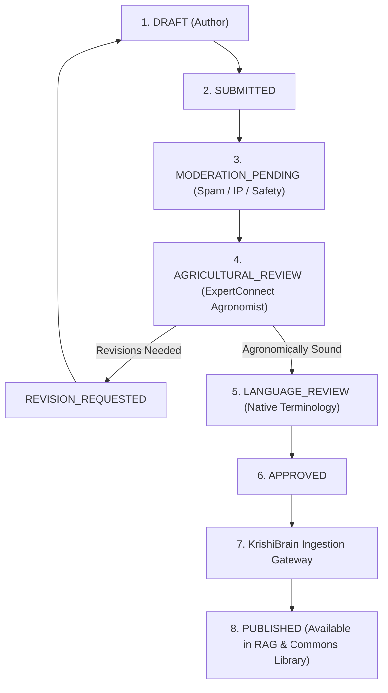

# ACREVIA — Knowledge Contribution Governance (ACREVIA Commons)
**Subsystem:** Pillar B — ACREVIA Commons  
**Primary Objective:** A governed pathway for community members, agronomists, and researchers to propose, peer-review, and graduate agricultural knowledge into KrishiBrain RAG.

---

## 1. Architectural Role & Boundary

ACREVIA Commons bridges grassroots agricultural observations and scientific literature. While ordinary community discussions remain conversational in Connect, substantive knowledge contributions undergo rigorous verification before they can be considered authoritative.

### Core Governance Rules:
1. **Never Automatically Ingest Community Posts:** A public forum post or comment **never** enters the KrishiBrain RAG index directly.
2. **Mandatory Agricultural Review:** Any agronomic claim or package of practices must be reviewed and endorsed by an ExpertConnect certified agronomist (`AGRICULTURAL_REVIEW`).
3. **Language & Terminology Review:** Contributions in Telugu, English, or Hindi must be checked for clarity and localized terminology (`LANGUAGE_REVIEW`).
4. **Provenance & Citation Binding:** Contributions must cite authoritative sources (ICAR, PJTSAU, State Agri Dept, or peer-reviewed publications) or document systematic field observation methodology.

---

## 2. Contribution Lifecycle & Review Gates

### Reviewer Decisions:
- `APPROVE`: The contribution meets scientific accuracy, safety criteria, and regional relevance.
- `REJECT`: Inaccurate, dangerous (e.g. unapproved pesticide schedules), or duplicative content.
- `REQUEST_REVISION`: Useful core insight requiring empirical clarification, dosage correction, or source citations.

---

## 3. KrishiBrain Handoff Protocol

When a contribution attains `APPROVED` status:
1. A new `KnowledgeDocument` record is created in KrishiBrain's knowledge store.
2. `source_id` is linked to the contributor and approving agronomist (`provenance_metadata`).
3. Text is chunked with structural headers and annotated with metadata: `crop_id`, `district`, `growth_stage`, `contributor_tier`.
4. High-dimensional vector embeddings (1536d) are generated and stored in Neon `knowledge_embeddings` via pgvector.
5. Ingestion job logs are audited with immutable timestamps.
