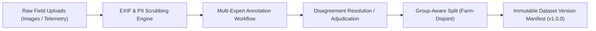

# ACREVIA — Research Hub & Data Governance Architecture
**Subsystem:** Pillar D — ACREVIA Research Hub  
**Primary Objective:** A governed collaborative environment for agricultural researchers, universities (e.g. PJTSAU), and agronomists to curate datasets, execute multi-expert image annotation, and resolve label disagreements.

---

## 1. Ethical Research Framework & Purpose Consent

Operational farm data is strictly separated from research data:
1. **Explicit Purpose-Specific Consent (`ResearchConsent`):**
   - General platform usage does **not** authorize research dataset publication or AI model training.
   - Farmers must explicitly opt-in with granular scopes:
     - `OBSERVATIONS_ONLY`: Anonymized symptom descriptions.
     - `ANNOTATED_IMAGES`: Field leaf/crop photography stripped of EXIF GPS coordinates.
     - `SENSOR_DATA`: Calibrated soil moisture and weather telemetry.
     - `FULL_RESEARCH`: Complete agronomic observation bundle.
2. **Revocation & Consent Lifecycle:**
   - Farmers can revoke research consent at any time.
   - Revocation excludes their data from all future dataset versions while preserving reproducibility for previously published immutable benchmarks.

---

## 2. Dataset Versioning & Split Integrity

### Group-Aware Splitting Rules:
To prevent data leakage and artificially inflated model evaluation scores:
- All observations, leaves, and images originating from the **same plant, plot, or farm session** are strictly grouped into the **same split** (Train, Validation, or Test).
- Train and Test splits are guaranteed to be farm-disjoint.

---

## 3. Multi-Expert Annotation & Disagreement Tracking

- **Independent Dual-Annotation:** For complex foliar diseases (e.g. distinguishing Bacterial Blight from Cercospora Leaf Spot in Cotton), tasks can be assigned to multiple certified experts.
- **Disagreement Flagging:** When experts assign conflicting labels or severe confidence divergence ($> 0.3$), the task is automatically flagged as `DISPUTED`.
- **Senior Adjudication:** Certified chief agronomists review disputed records to establish gold-standard ground truth.
