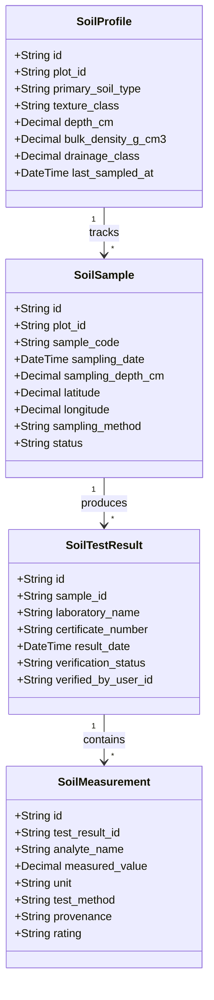
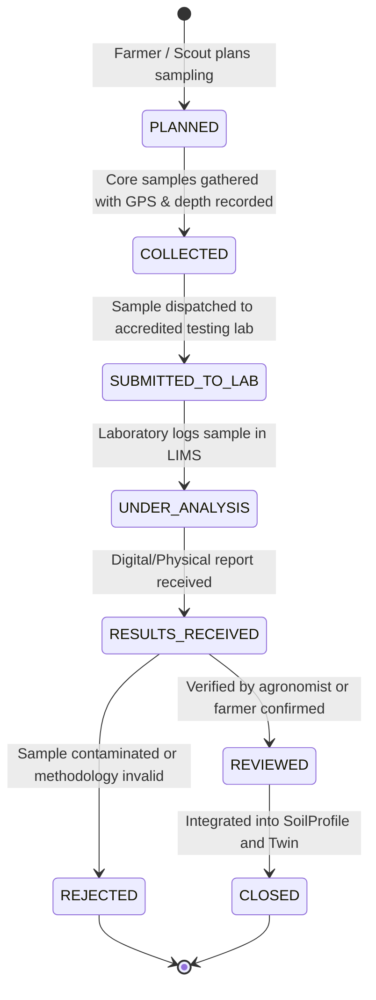

# ACREVIA — Soil Health Intelligence & Monitoring
## Pillar A Architecture Specification: Soil Profiles, Sampling Workflows, Laboratory Results & Provenance

---

## 1. Soil Health Principles in ACREVIA

Soil health intelligence in ACREVIA is grounded in empirical soil science, strictly separating laboratory-measured values from sensor readings, farmer observations, and pedotransfer estimates.

### Non-Negotiable Guardrails
1. **Never guess or interpolate soil chemistry:** If a soil parameter (e.g., available phosphorus, exchangeable potassium, zinc) has not been tested, the system reports `NOT_MEASURED` rather than imputing a regional average.
2. **Never derive soil nutrients from satellite imagery:** Satellite vegetation indices (NDVI, NDRE, EVI) reflect canopy chlorophyll and leaf area index; they are not direct assays of soil nutrients or soil organic carbon.
3. **Sampling Depth & Methodological Comparability:** Measurements taken at 0–15 cm (plow layer) cannot be directly compared against 15–30 cm subsoil samples without explicit depth normalization.
4. **Spatial Coverage Integrity:** A single soil sample cannot be interpolated into a field-wide soil fertility heatmap. If sampling density is insufficient (< 1 sample per 2.5 acres), ACREVIA flags `INSUFFICIENT_SPATIAL_COVERAGE`.

---

## 2. Soil Profile & Chemical Attributes

For each plot in Telangana, ACREVIA maintains a comprehensive soil profile:

### Supported Analytes and Standard Test Methods (Telangana Vertisols & Alfisols)

| Analyte | Standard Units | Approved Analytical Method | Telangana Critical Ranges (PJTSAU) |
|---|---|---|---|
| **pH (1:2.5 Soil:Water)** | pH units | Potentiometric Glass Electrode | < 6.5 (Acidic), 6.5–7.5 (Neutral), 7.5–8.5 (Moderately Alkaline), > 8.5 (Sodic/Alkaline) |
| **Electrical Conductivity (EC)** | dS/m | Conductometric (1:2.5 Suspension) | < 1.0 (Normal), 1.0–2.0 (Critical for germination), > 2.0 (Saline/Injurious) |
| **Soil Organic Carbon (SOC)** | % | Walkley-Black Wet Oxidation | < 0.50% (Low), 0.50–0.75% (Medium), > 0.75% (High) |
| **Available Nitrogen ($N$)** | kg/ha | Alkaline Permanganate Method (Subbiah & Asija) | < 280 kg/ha (Low), 280–560 kg/ha (Medium), > 560 kg/ha (High) |
| **Available Phosphorus ($P_2O_5$)** | kg/ha | Olsen's 0.5M $NaHCO_3$ Method | < 23 kg/ha (Low), 23–56 kg/ha (Medium), > 56 kg/ha (High) |
| **Available Potassium ($K_2O$)** | kg/ha | Neutral 1N Ammonium Acetate Flame Photometry | < 145 kg/ha (Low), 145–337 kg/ha (Medium), > 337 kg/ha (High) |
| **Available Sulphur ($S$)** | mg/kg (ppm) | $0.15\%\;CaCl_2$ Turbidimetric Method | < 10 ppm (Deficient), 10–20 ppm (Medium), > 20 ppm (Sufficient) |
| **Available Zinc ($Zn$)** | mg/kg (ppm) | DTPA Extraction AAS / ICP-OES | < 0.65 ppm (Deficient), ≥ 0.65 ppm (Sufficient) |
| **Available Boron ($B$)** | mg/kg (ppm) | Hot Water Soluble Azomethine-H | < 0.50 ppm (Deficient), ≥ 0.50 ppm (Sufficient) |
| **Available Iron ($Fe$)** | mg/kg (ppm) | DTPA Extraction AAS | < 4.5 ppm (Deficient), ≥ 4.5 ppm (Sufficient) |

---

## 3. Soil Sampling Lifecycle & Chain-of-Custody

### Provenance Tracking
Every discrete soil measurement stores an explicit `MeasurementProvenance`:
- `LABORATORY_MEASURED`: Analyzed in an accredited laboratory following recognized wet chemistry or ICP-OES procedures.
- `CALIBRATED_SENSOR_MEASURED`: Calibrated in-situ electronic probes (e.g., TDR soil moisture, ion-selective electrodes with active buffer calibration).
- `FARMER_REPORTED`: Visual or tactile assessment reported by the grower (e.g., surface crusting, color, stoniness).
- `EXPERT_REVIEWED`: Professional agronomic field assessment.
- `PROVIDER_SUPPLIED`: Official government Soil Health Card portal data (Mandi/KVK issued).
- `MODEL_ESTIMATED`: Pedotransfer function (e.g., Saxton-Rawls water retention curves from texture).

---

## 4. Longitudinal Soil Monitoring & Comparability

When comparing soil test results across seasons:
1. **Methodology Compatibility Check:** If Sample A used Walkley-Black for SOC and Sample B used Loss-on-Ignition, they are flagged as `NON_COMPARABLE_METHODOLOGY`.
2. **Depth Alignment:** Only measurements taken within the same depth interval (e.g., 0–15 cm) are compared chronologically.
3. **Seasonal Normalization:** Soil test history highlights sampling timing relative to crop harvest and basal fertilizer application to prevent false degradation signals caused by crop nutrient extraction.
